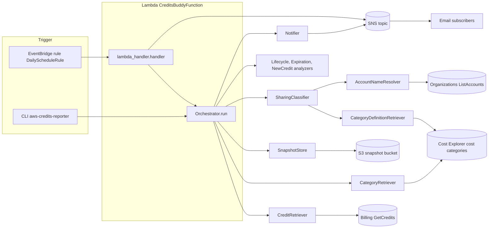
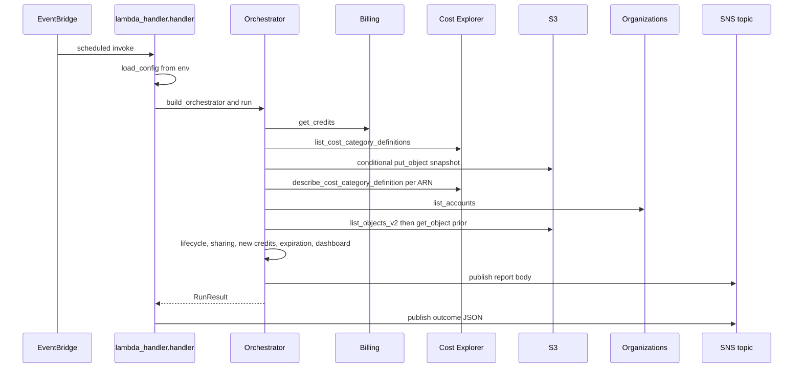
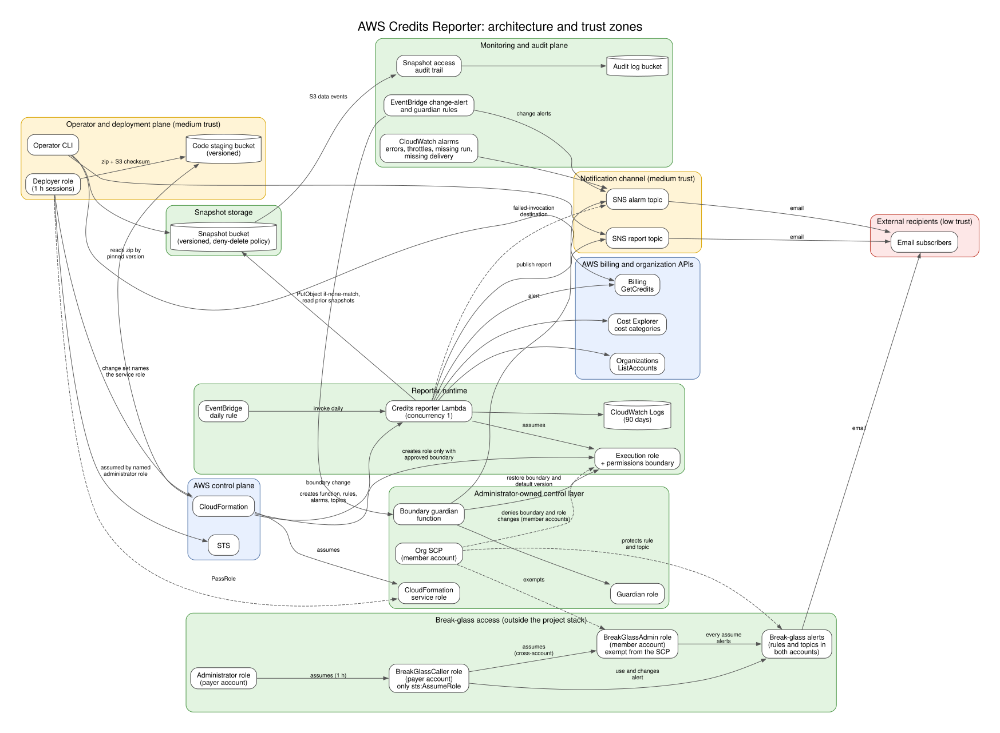
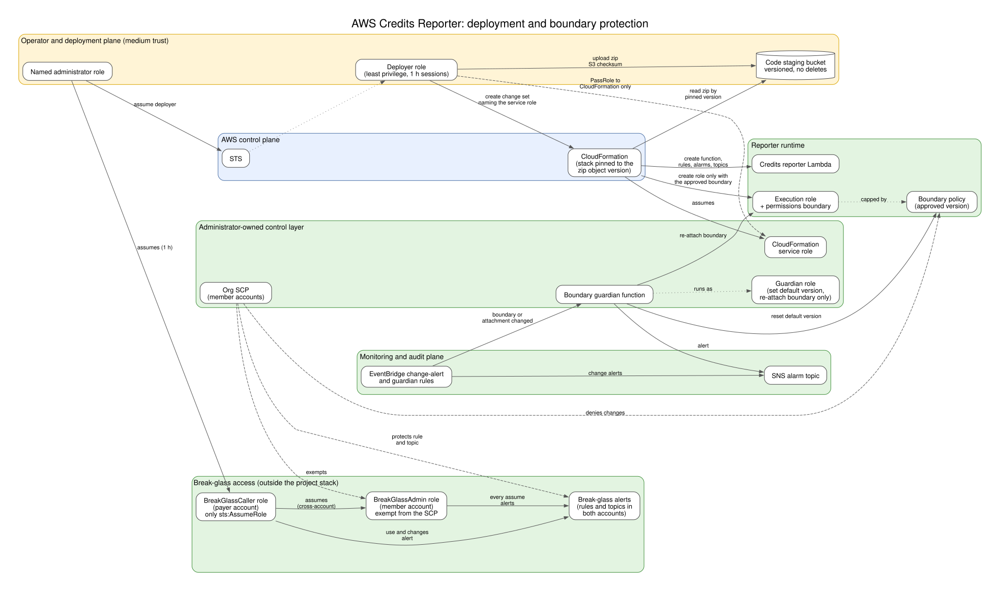
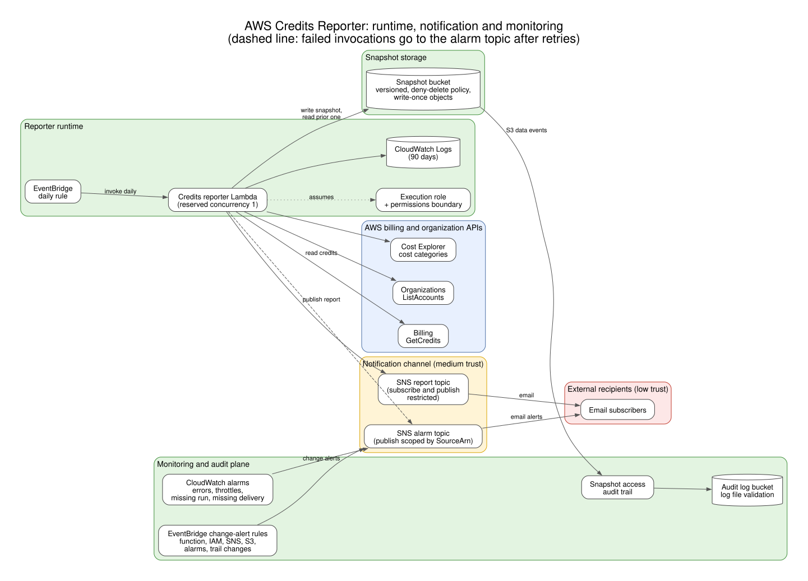

# AWS Credits Reporter: Design Document

Audience: the engineering and FinOps team that deploys and operates this sample in an AWS Organizations payer (management) account.

Scope of this document: the Python package `aws_credits_reporter/`, the CloudFormation stack `infra/cloudformation.yaml`, the scripts `infra/package.sh` and `infra/install.sh`, and the two IAM files `docs/deployer-iam-policy.json` and `docs/deployer-permissions-boundary.json`. Every claim cites a file path and, where useful, a function or resource name. Items that could not be confirmed from code or documentation are collected in [Open questions](#16-open-questions-and-unverified-assumptions).

Status of the deployer IAM work: the template, the scripts and the two IAM files enforce a permissions boundary on the Lambda execution role (sections 9 and 10). The deployer policy was derived from the CloudFormation resource handler permissions, the `aws cloudformation deploy` call set and the Service Authorization Reference.

This is sample code for non-production use. Review it with your security and legal teams and test it in a non-production account before you adopt any part of it.

## Contents

1. [Overview and goals](#1-overview-and-goals)
2. [Non-goals](#2-non-goals)
3. [Architecture](#3-architecture)
4. [Component and module reference](#4-component-and-module-reference)
5. [Data model](#5-data-model)
6. [Key algorithms and rules](#6-key-algorithms-and-rules)
7. [Interfaces](#7-interfaces)
8. [Infrastructure](#8-infrastructure)
9. [Deployment](#9-deployment)
10. [Deployer IAM model](#10-deployer-iam-model)
11. [Security considerations](#11-security-considerations)
12. [Testing strategy](#12-testing-strategy)
13. [Delivery phases and history](#13-delivery-phases-and-history)
14. [Risks, limitations and future work](#14-risks-limitations-and-future-work)
15. [Traceability: IAM actions to template and scripts](#15-traceability-iam-actions-to-template-and-scripts)
16. [Open questions and unverified assumptions](#16-open-questions-and-unverified-assumptions)
17. [Break-glass roles for member accounts (optional)](#17-break-glass-roles-for-member-accounts-optional)
18. [Boundary guardian](#18-boundary-guardian)

---

## 1. Overview and goals

AWS Credits Reporter is a self-service FinOps tool for the payer account of an AWS Organization. On each run it answers four questions: what credits are new, what is the status of each credit, which credits are about to expire, and who the credits are shared with.

One run (`Orchestrator.run()` in `aws_credits_reporter/orchestrator.py`) does the following:

- Retrieves all organization credits from the Billing `GetCredits` API.
- Persists the raw JSON response as an immutable snapshot in S3.
- Derives each credit's lifecycle status and classifies its sharing option.
- Diffs the credit IDs against the previous snapshot to find new credits.
- Buckets expirations, builds a dashboard, renders a plain-text report, and publishes it to an SNS topic.

There are two run modes:

- **CLI**: console script `aws-credits-reporter`, entry `aws_credits_reporter.cli:main` (`pyproject.toml`, `[project.scripts]`).
- **Scheduled Lambda**: `aws_credits_reporter.lambda_handler.handler`, invoked daily by EventBridge and deployed by `infra/cloudformation.yaml`.

Goals:

- Daily, hands-off reporting with no database and no always-on compute.
- Least privilege at runtime (the Lambda role) and at deploy time (the deployer policy and permissions boundary in `docs/`).
- Degrade gracefully: optional enrichment (cost categories, account names, prior-snapshot comparison, SNS delivery) must never fail the run. Only credit retrieval and the snapshot write are fatal.
- Make all behavior testable offline (botocore `Stubber`, `moto`, Hypothesis).

## 2. Non-goals

- Cost or usage analytics. The code calls no Cost Explorer usage or cost API (`ce` is used only for cost category definitions).
- Currency conversion. Mixed-currency totals are summed raw and a warning is recorded (`orchestrator.summarize_remaining`).
- Multi-account fan-out. The tool is designed to run in the payer account only (`README.md`, "Deployer permissions").
- A UI, API, or inbound network surface. The only trigger is the EventBridge schedule.
- Email delivery without operator action. The template creates no SNS subscription (`infra/cloudformation.yaml`, `CreditsTopic`).
- SES delivery. SNS is the only backend (`aws_credits_reporter/notifier.py` module docstring; removed variables are ignored per `tests/test_lambda_handler.py::test_removed_notification_variables_are_ignored`).

## 3. Architecture

### 3.1 Component diagram



Components are injected into the orchestrator through protocols (`_CreditRetrieverLike`, `_SnapshotStoreLike`, `_NotifierLike`, and others in `orchestrator.py`), so the orchestrator owns no AWS clients. Real client wiring lives only in `wiring.build_orchestrator`, which both `cli.build_orchestrator` and `lambda_handler.build_orchestrator` call with plain keyword arguments.

### 3.2 Run sequence



### 3.3 Ordered steps in `Orchestrator.run()`

1. **Retrieve credits** with `CreditRetriever.retrieve()`. `RetrievalError` and `AuthorizationError` become `RunResult(success=False, error_message=...)`. Other exceptions propagate.
2. Record missing-field messages and totals (`missing_field_messages`, `summarize_remaining`).
3. **Retrieve cost categories** with `CategoryRetriever.retrieve()` before the snapshot write, so raw pages are stored in the same object. It never raises. A failure is recorded and the run continues with zero categories.
4. **Write the snapshot** with `SnapshotStore.write()`. `SnapshotWriteError` is fatal.
5. **Lifecycle partition** with `LifecycleAnalyzer(snapshot_date).partition()`. The snapshot date is the UTC date of `taken_at`.
6. **Sharing classification** with `SharingClassifier.classify()`.
7. **Attention items** with `build_attention_items()`. This is a pure, informational step.
8. **New credit detection**: `SnapshotStore.read_latest_prior(before_key=current_key)` then `NewCreditDetector.detect()`. A prior read failure is a comparison error, never fatal.
9. **Expiration tiers** with `ExpirationAnalyzer(taken_at).classify(lifecycle.active)`.
10. **Dashboard** with `build_dashboard()`.
11. **Notify** (optional): `build_dashboard_body()` then `Notifier.send()`. Delivery failure never fails the run.
12. `result.success = True`.

### 3.4 Architecture and trust zones



The whole system on one page, grouped by trust. The colours are the trust levels: yellow is medium trust (the operator and deployment plane, and the notification channel), green is owned by an administrator or by the project and is protected by the controls in sections 8 and 10, blue is the AWS control plane and AWS APIs, and red is external (email subscribers).

- **Daily run.** The EventBridge rule invokes the Lambda function, which reads the billing APIs, writes the snapshot, publishes the report and logs. A failed invocation goes to the alarm topic.
- **Deployment.** The deployer role uploads the zip, creates a change set that names the CloudFormation service role, and passes only that role to CloudFormation. CloudFormation creates the function and the execution role, and only with the approved permissions boundary (sections 10.3 and 10.4).
- **Monitoring.** CloudWatch alarms and the EventBridge change-alert and guardian rules publish to the alarm topic. The snapshot access audit trail writes to its own bucket.
- **Break-glass access** is outside the project stack: the payer `Administrator` role assumes `BreakGlassCaller`, which can only assume `BreakGlassAdmin` in the member account, the one role the organization SCP exempts. Every assume of either role raises an email alert, and so do changes to the caller role or to the alerts (section 17).

### 3.5 Deployment and boundary protection



How a release reaches the account and what protects the permissions boundary. The deployer role holds no Lambda, IAM or SNS write permissions of its own; the CloudFormation service role does the writes, and it can create the execution role only with the approved boundary. The boundary guardian restores the boundary and its approved default version when they change, and alerts. In member accounts the organization SCP also denies changes to the boundary, the deployer and service roles and the break-glass alert resources. Sections 10 and 11 give the policies, and sections 17 and 18 describe the break-glass roles and the guardian.

### 3.6 Runtime, notification and monitoring



The data flow of a run and the monitoring around it. The function reads credits, cost categories and account names, writes one snapshot object, and publishes the report to the report topic, whose subscribe and publish rights are restricted. The alarm topic receives failures, alarm state changes and change alerts, and its publish rights are scoped by source ARN. Snapshot reads and writes are recorded by the audit trail.

The diagrams are generated from `architecture.dot`, `architecture-deployment.dot` and `architecture-runtime.dot` in this folder. After changing a source, render it again, for example `dot -Tsvg architecture.dot -o architecture.svg` and `dot -Tpng -Gdpi=160 architecture.dot -o architecture.png`.

## 4. Component and module reference

All modules are in `aws_credits_reporter/`. The package has one runtime dependency, `boto3>=1.43,<2` (`pyproject.toml`).

### `models.py`
Responsibility: data types, tolerant parsers, lifecycle rule. Key items: `CurrencyAmount`, `Credit`, `CostCategory`, `MemberAccount`, `CostCategoryDefinition`, `Snapshot`, `parse_credit`, `parse_credits`, `parse_cost_category`, `parse_cost_categories`, `LifecycleStatus`, `lifecycle_status`. Parsers never raise, and API strings pass through `sanitize_text` (also applied to Organizations account names and rule member ids) to neutralize control characters (log and email injection).

### `aws_calls.py`
Responsibility: shared mechanics for AWS calls. Key items: `call_with_backoff` (retry with exponential backoff, injectable `sleep`, caller-supplied `is_retryable`), `client_error_details`, `is_authorization_error`, `BACKOFF_BASE_SECONDS`. Each retriever and the snapshot store keep their own retry policy. `Notifier.send` keeps its own loop because it also enforces an overall deadline.

### `aggregation.py`
Responsibility: one implementation of the remaining-amount sum and tier summary. Key items: `TierSummary`, `sum_remaining`, `summarize`, `count_label`. `TierSummary` is still importable from `expiration_analyzer`.

### `credit_retriever.py`
Responsibility: call Billing `GetCredits` with retry and backoff. Key items: `CreditRetriever.retrieve`, `make_billing_client`, `resolve_account_id` (STS `GetCallerIdentity`), `RetrievalError`, `AuthorizationError`, `is_retryable_error`. Billing and STS are pinned to `BILLING_REGION = "us-east-1"`. `GetCredits` is called with `DEFAULT_START_DATE = 2020-01-01` and `payerAccountFlag=True`.

### `category_retriever.py`
Responsibility: list cost category definitions. Key items: `CategoryRetriever.retrieve` (returns `CategoryRetrievalOutcome`, never raises), `make_cost_explorer_client` (30 second timeouts, botocore retries disabled, own retry loop of 3).

### `category_definition_retriever.py`
Responsibility: fetch the authoritative definition for a cost category ARN. Key items: `CategoryDefinitionRetriever.describe` (3 attempts, memoized per ARN).

### `account_name_resolver.py`
Responsibility: best-effort account ID to name mapping. Key items: `AccountNameResolver.resolve` (one `list_accounts` sweep, cached, never raises), `make_organizations_client`, `AccountNameResolution`. Falls back to bare account IDs when Organizations denies the call.

### `sharing_preferences.py`
Responsibility: best-effort credit sharing state per account. Key items: `CreditSharingPreferences.is_enabled`, `account_name`, `consulted`, `unavailable`, `error_message`. It calls Billing `GetBillingPreferences` for the `CREDIT_SHARING` feature once (paginated, cached) and never raises: a denied call, a connection error, or a boto3 without the operation makes the preferences unavailable and the members unmarked. Account entries (`account/<id>`) carry `ENABLED` or `DISABLED` and the account name.

### `snapshot_store.py`
Responsibility: the sole persistence layer (S3). Snapshot keys order by (timestamp, numeric collision suffix), so `...Z-1.json` is later than `...Z.json`. Key items: `SnapshotStore.write`, `read`, `read_latest_prior`, `make_key`, `serialize`, `deserialize`, `SnapshotWriteError`, `SnapshotReadError`.

### `lifecycle_analyzer.py`
Responsibility: split credits into Active and Inactive. Key items: `LifecycleAnalyzer.partition`, `LifecycleResult(active, inactive, status_by_id)`.

### `new_credit_detector.py`
Responsibility: set difference of `creditId` against the prior snapshot. Key items: `NewCreditDetector.detect`, `NewCreditResult`, `BASELINE_MESSAGE`, `COMPARISON_ERROR_MESSAGE`.

### `expiration_analyzer.py`
Responsibility: bucket Active credits by `endDate`. Key items: `compute_window`, `ExpirationAnalyzer.classify`, `ExpirationResult`, `TierSummary`.

### `sharing_classifier.py`
Responsibility: classify each credit as `Sharing disabled`, `cost-category-based`, or `Shared by default`. First match wins: `creditSharingType == DISABLED` gives `Sharing disabled`; a non-empty `shareableAccounts` gives `Shared by default`; a full `costCategoryArn` plus `ruleName` binding gives `cost-category-based`; anything else is `Shared by default`. A disabled credit with a full binding still carries the binding details (category, rule, members), because the Paused alert shows them. Each member account carries `sharing_enabled` (`True`, `False`, or `None` when unknown) from `CreditSharingPreferences`. Key items: `SharingClassifier.classify`, `SharingGroup` (with `owner_account_name`), `SharingResult`, `COST_CATEGORY_BASED`, `SHARED_BY_DEFAULT`, `SHARING_DISABLED`, `UNRESOLVED_NAME`.

### `attention_builder.py`
Responsibility: collect unresolved or missing information into a "NEEDS ATTENTION" list. Key items: `build_attention_items`, `AttentionItem`.

### `dashboard.py`
Responsibility: aggregate counts and totals for the report. Key items: `Dashboard`, `build_dashboard`, `format_money`.

### `report_body.py`
Responsibility: render the plain-text report (pure, no I/O). Key items: `build_dashboard_body` (takes `payer_account_id` and `payer_account_name` for the title), `overview_heading`, `PAUSED_LABEL`, `EXPIRED_WINDOW_MONTHS = 3`, the section heading constants.

### `notifier.py`
Responsibility: publish the body to SNS. Key items: `Notifier.send` (3 attempts under a 300 second deadline), `NotifyResult`, `DEFAULT_SUBJECT`.

### `orchestrator.py`
Responsibility: sequence the run. Key items: `Orchestrator` (optional `sharing_preferences` and `payer_account_id`), `RunResult` (with `payer_account_id` and `payer_account_name`), `summarize_remaining`, `missing_field_messages`, `sharing_resolution_messages`. The payer name is resolved through Organizations first, then through the sharing preferences.

### `wiring.py`
Responsibility: the only place real clients are built. Key items: `build_orchestrator` (keyword arguments), `build_notifier`, `SetupError`, `DEFAULT_PREFIX`.

### `cli.py`
Responsibility: argparse entry point, output formatting, exit codes. Key items: `build_parser`, `build_orchestrator` and `build_notifier` (thin adapters over `wiring`), `run`, `main`.

### `lambda_handler.py`
Responsibility: scheduled entry point and outcome messages. Key items: `handler`, `load_config`, `LambdaConfig`, `build_sns_client`, `RunOutcome`, `publish_outcome`, `ConfigurationError`, `RunFailedError`.

### `guardian.py`

Responsibility: the boundary guardian, a second Lambda function deployed from the same package when `EnableBoundaryGuardian` is `true`. Key items: `handler`, `reconcile` (makes the default version of the boundary policy equal `APPROVED_BOUNDARY_VERSION` and re-attaches the boundary to the execution role, each check in its own `try`), `GuardianResult`, `GuardianConfigurationError`. It reads `BOUNDARY_POLICY_ARN`, `APPROVED_BOUNDARY_VERSION`, `EXECUTION_ROLE_NAME` and `ALARM_TOPIC_ARN` from the environment, runs as a role created outside the stack, and shares no state with the reporter run. See section 18.

## 5. Data model

Types in `aws_credits_reporter/models.py`:

| Type | Purpose | Notable fields |
|---|---|---|
| `CurrencyAmount` | amount with currency | `amount: Decimal`, `currency: str` |
| `Credit` | one `GetCredits` record | the 19 `CREDIT_FIELDS` (below) plus `missing_fields` |
| `CostCategory` | reference from `ListCostCategoryDefinitions` | the 8 `COST_CATEGORY_FIELDS` plus `missing_fields` |
| `CostCategoryDefinition` | full definition from `DescribeCostCategoryDefinition` | `arn`, `name`, `rules`, `processing_complete` |
| `MemberAccount` | one account a bound rule shares with | `account_id`, `account_name` (may be `None`) |
| `Snapshot` | one run's raw data | `key`, `taken_at`, `raw_get_credits`, `raw_cost_categories` |

`CREDIT_FIELDS`: `creditId, accountId, creditType, initialAmount, remainingAmount, estimatedAmount, applicableProductNames, description, startDate, endDate, applicationType, shareableAccounts, accountHasCreditSharingEnabled, creditConsoleVisibility, creditSharingType, creditStatus, exhaustDate, costCategoryArn, ruleName`.

Parsing rules: every field is optional. Absent or unparsable fields are listed in `Credit.missing_fields`. Amounts accept `{currencyAmount, currencyCode}` or `{amount, currency}` and become `Decimal`. Dates accept `date`, `datetime` (timezone-aware values converted to UTC), ISO strings, and a trailing `Z`.

### Snapshot schema

One JSON document per run, produced by `SnapshotStore.serialize`:

```json
{
  "taken_at": "<UTC ISO-8601>",
  "get_credits": ["<raw GetCredits pages, ResponseMetadata removed>"],
  "cost_categories": ["<raw ListCostCategoryDefinitions pages>"]
}
```

- `deserialize` tolerates a missing `cost_categories` (older objects).
- Datetimes and Decimals are stringified by `_json_default`.
- `DescribeCostCategoryDefinition` results are not stored.
- The stored snapshot holds raw, unsanitized pages. Sanitization happens at parse time.

Key format: `<prefix>YYYYMMDDTHHMMSSZ.json` in UTC (`SnapshotStore.make_key`). Objects are never overwritten: every `put_object` sends `IfNoneMatch="*"`, S3 answers 412 for an existing key, and the store then appends `-<n>` (up to 1000). Keys order by (timestamp, numeric suffix), so `...Z-1.json` is later than `...Z.json`. There is no `head_object` pre-check, so the runtime role does not depend on `s3:ListBucket` semantics for a missing key.

Runtime config (`LambdaConfig`): `bucket`, `outcome_topic_arn`, `prefix`, `region`, `sns_topic_arn`, `publish_success_outcome`. Run outcome (`RunOutcome`): `success, finished_at, snapshot_key, credit_count, total_remaining, remaining_currency, delivery_failed, error_message, error_type, messages, request_id`.

## 6. Key algorithms and rules

### 6.1 Credit sharing classification (`SharingClassifier.classify`)

First match wins:

1. `shareableAccounts` non-empty: `Shared by default`.
2. `shareableAccounts` empty and `costCategoryArn` and `ruleName` both non-empty: `cost-category-based`.
3. Anything else, including a partial binding: `Shared by default`.

### 6.2 Cost category binding (cost-category-based credits)

- The category name is resolved by matching the ARN against the listed categories (otherwise the marker `unresolved`).
- The definition comes from `CategoryDefinitionRetriever.describe`, memoized per ARN.
- The rule is the entry whose `Value` equals the credit's `ruleName`.
- Member accounts come from `Rule.Dimensions` where `Key == "LINKED_ACCOUNT"` (`_rule_member_account_ids`). Unexpected shapes yield an empty list.
- Account names come from `AccountNameResolver`; unresolved names fall back to the bare ID.
- If the definition cannot be retrieved, `member_accounts_unavailable` is set and the credit is reported under attention items.

### 6.3 Lifecycle states (`models.lifecycle_status`, first match wins)

1. `endDate` present and earlier than the snapshot date: **Expired**.
2. `exhaustDate` present, or `remainingAmount.amount == 0`: **Exhausted**.
3. `creditStatus == "DISABLED"`: **Disabled** (labelled "Paused" in the email, `report_body.PAUSED_LABEL`).
4. Otherwise: **Active**.

### 6.4 Expiration buckets (`expiration_analyzer.compute_window`)

Applied to Active credits only, in the UTC month of the snapshot time:

- **This month**: first day of month <= `endDate` <= last day of month.
- **Next three months**: last day of month < `endDate` <= last day of the month three months ahead.
- Credits with no `endDate`, or beyond the window, are in no bucket.

### 6.5 New credit detection (`NewCreditDetector.detect`)

- Normal: `new = current creditIds - prior creditIds`. Credits without `creditId` are never new.
- No prior snapshot: initial baseline, nothing flagged (`BASELINE_MESSAGE`).
- Prior unreadable (`prior_read_ok=False`): comparison error, nothing flagged, detection halted (`COMPARISON_ERROR_MESSAGE`). This takes precedence over the baseline case.
- The prior snapshot is the latest key strictly earlier than the current key, ordered by (timestamp, collision suffix) (`read_latest_prior`).

### 6.6 Attention rules (`attention_builder.build_attention_items`)

One `AttentionItem` per `creditId`, ordered by ID, with reasons in a fixed order. A credit is listed when:

- (Active credits only) exactly one of `costCategoryArn` and `ruleName` is set (partial binding).
- (Active credits only) a cost-category-based credit has an unresolved category name, an unresolved rule, or an unretrievable definition.
- (Active credits only) member accounts are unavailable or some member account names are unresolved.
- (All credits) `remainingAmount`, `endDate`, or `creditStatus` is missing.

A missing `exhaustDate` never produces an item. Classification is never changed by this step.

### 6.7 Report body (`report_body.build_dashboard_body`)

In order: the title `AWS CREDITS OVERVIEW FOR PAYER <id> (<name>)` (always present; the name is dropped when it cannot be resolved, and the `FOR PAYER` part when the payer id is unknown), then the alert blocks (new credits, `Paused credits`, expiring this month, expiring next three months; each only when non-empty), `CREDITS DASHBOARD SUMMARY`, `Credits by sharing option`, optional `NEEDS ATTENTION`, and a trailing `INACTIVE CREDITS` or `EXPIRED CREDITS IN THE LAST 3 MONTHS` listing. The trailing listing holds only Expired credits within three calendar months of the snapshot date (`_expired_within_window`) and Exhausted credits; Paused credits are shown in the `Paused credits` alert instead. When there is nothing to list the trailing section is omitted entirely (there is no empty-state sentence). The `Paused credits` bullet is the inactive-credit line plus, for a credit with a cost category binding, the cost category annotation, plus `[credit sharing DEACTIVATED for the owning account <id>]` when `creditSharingType` is `DISABLED`.

The sharing block has three rows: `cost-category-based` (one sub-bullet per category and rule, each followed by an `accounts:` line; a member whose credit sharing is off is marked `(sharing off)`), `Shared by default`, and `Sharing disabled` (one sub-bullet per credit naming its owning account). Figures are Active_Credits only. The SNS subject is `DEFAULT_SUBJECT` ("AWS Credits Reporter - Credit Status Report"), truncated to 100 characters.

### 6.8 Retry and timeout constants

Credits: 5 attempts, backoff base 0.5 seconds. Cost Explorer list and describe: 3 attempts each, 30 second call timeout. Snapshot put: 3 attempts. SNS publish: 3 attempts under a 300 second deadline.

## 7. Interfaces

### 7.1 CLI (`cli.build_parser`)

| Flag | Meaning |
|---|---|
| `--bucket` | required snapshot bucket |
| `--prefix` | key prefix, default `snapshots/`; used verbatim, so include the trailing `/` |
| `--profile` | boto3 profile name |
| `--region` | region for the session default, S3 and SNS clients |
| `--sns-topic-arn` | enables report delivery |
| `--dry-run` | prepare the notification but do not call SNS |

Exit code `0` on success, `1` on `SetupError` or `RunResult.success=False`. Notification outcomes never change the exit code. Notification is opt-in: it runs only when `--sns-topic-arn` or `--dry-run` is given (`notification_requested`). `--dry-run` without a topic records a configuration error and builds no SNS client.

### 7.2 Lambda event and environment (`lambda_handler.py`)

The event payload is ignored. Handler string: `aws_credits_reporter.lambda_handler.handler`.

| Variable | Required | Set by template | Effect |
|---|---|---|---|
| `AWS_CREDITS_REPORTER_BUCKET` | yes | `SnapshotBucketName` | snapshot bucket |
| `AWS_CREDITS_REPORTER_OUTCOME_TOPIC_ARN` | yes | topic ARN | run outcome topic |
| `AWS_CREDITS_REPORTER_PREFIX` | no | `SnapshotPrefix` | default `snapshots/` |
| `AWS_CREDITS_REPORTER_SNS_TOPIC_ARN` | no | topic ARN | enables report delivery |
| `AWS_CREDITS_REPORTER_REGION` | no | not set | S3 and SNS client region, falls back to the Lambda region |
| `AWS_CREDITS_REPORTER_PUBLISH_OUTCOME` | no | `PublishRunOutcome` | `true` (default) or `false`; `false` skips the outcome message of a successful run only. Failure outcomes are always published. Any other value raises `ConfigurationError`. |

Behavior: `load_config` raises `ConfigurationError` before any client is built when a required variable is missing, and no outcome message is published in that case. The SNS client is also built before the `try` block of `handler`, so an exception while building it (for example an invalid `AWS_CREDITS_REPORTER_REGION`) publishes no outcome either. An exception from `run()` is logged with `logger.exception`, a failure outcome is published (exception type and request ID only), and the exception is re-raised. `success=False` publishes a failure outcome and raises `RunFailedError`. Success publishes a success outcome (unless `AWS_CREDITS_REPORTER_PUBLISH_OUTCOME=false`) and returns the outcome as a dict. A failed outcome publish (success or failure path) is logged and never changes the result, so a transient SNS problem cannot make Lambda retry a completed run.

### 7.3 Notifications

Both go to the same topic in the template (the outcome message can be switched off for successful runs with `PublishRunOutcome=false`):

- **Report** (`Notifier.send`): plain text, subject "AWS Credits Reporter - Credit Status Report". Contains credit IDs, amounts, descriptions, and for cost-category-based credits the member account IDs and names.
- **Outcome** (`publish_outcome`): JSON from `RunOutcome.to_json`. `total_remaining` is the sum of `remainingAmount.amount` over every credit that carries one (`summarize_remaining` in `aws_credits_reporter/orchestrator.py`), whatever its lifecycle status, so it includes expired, exhausted and paused credits. It is not the usable balance: the dashboard in the report body counts Active credits only. Subjects: "AWS Credits Reporter: scheduled run succeeded" and "AWS Credits Reporter: scheduled run FAILED". A failure the run handles itself carries its recorded error text; an unexpected exception carries only the exception type and a generic message (see "Logging and injection" in section 11).

Subscribers must be added after deploy by an administrator whose role matches `TopicManagerPrincipalPattern`, for example `aws sns subscribe --protocol email` (`README.md`, "Quick start"). The deployer is denied `sns:Subscribe` and `sns:Publish`.

## 8. Infrastructure

`infra/cloudformation.yaml` is plain CloudFormation (no SAM transform). It requires `--capabilities CAPABILITY_NAMED_IAM` because the role is named.

### 8.1 Parameters

| Parameter | Default | Notes |
|---|---|---|
| `CodeS3Bucket` | none | existing staging bucket, same region |
| `CodeS3Key` | `lambda/aws-credits-reporter.zip` | |
| `CodeS3ObjectVersion` | empty | needs staging bucket versioning; `install.sh` always sets it to the uploaded version, which pins the code and forces redeploy of new code |
| `FunctionName` | `aws-credits-reporter-lambda` | `AllowedPattern: 'aws-credits-reporter.*'` |
| `ScheduleExpression` | `cron(0 8 * * ? *)` | 08:00 UTC |
| `LambdaMemorySize` | 1024 | 128 to 10240 |
| `LambdaTimeout` | 600 | 3 to 900 |
| `CreateSnapshotBucket` | `'true'` | `true` or `false` |
| `SnapshotBucketName` | none | `AllowedPattern: '[a-z0-9][a-z0-9.-]{1,61}[a-z0-9]'` |
| `SnapshotPrefix` | `snapshots/` | no validation |
| `CreateSnsTopic` | `'true'` | `true` or `false` |
| `SnsTopicName` | `aws-credits-reporter-topic` | no validation |
| `ExistingTopicArn` | empty | required by Rule `ExistingTopicArnRequiredWhenReusing` when `CreateSnsTopic=false` |
| `TopicManagerPrincipalPattern` | empty | Role ARN pattern (wildcards allowed) of the administrators who may subscribe to and publish on the created topic. `AllowedPattern: '^$|^arn:aws[a-zA-Z-]*:iam::[0-9]{12}:role/[^*?]{4}.*$'` (the first 4 characters of the role name or path must not be wildcards). Empty means nobody can subscribe through IAM and only the execution role can publish. Ignored when reusing a topic. |
| `SnapshotAdminPrincipalPattern` | empty | Role ARN pattern of administrators who may delete snapshots and write them outside the function. Empty means only the execution role writes and nobody deletes. Applies only to a bucket the stack creates. It is also the only way to empty the bucket before stack deletion, so set it at install time. |
| `SnapshotNoncurrentRetentionDays` | 365 | `NoncurrentVersionExpiration` of the created bucket. |
| `SnapshotObjectLockDays` | 0 | Object Lock GOVERNANCE default retention in days for the created bucket; 0 is off. Enabling it on an existing stack-created bucket was an in-place update, and the retention applies only to snapshots written afterwards. |
| `PublishRunOutcome` | `'true'` | `true` or `false`; `false` skips the run-outcome message for successful runs (failed runs always publish) |
| `CreateLogGroup` | `'true'` | `true` or `false`; `true` creates `/aws/lambda/<FunctionName>` with `LogRetentionDays`, `false` leaves it to Lambda |
| `LogRetentionDays` | 90 | one of 1, 3, 5, 7, 14, 30, 60, 90, 120, 150, 180, 365, 400, 545, 731, 1827 or 3653 days (a subset of the CloudWatch Logs retention values); used when the stack creates the log group |
| `EnableBoundaryGuardian` | `'false'` | deploys the guardian function and its two rules. A Rule requires `GuardianRoleArn` and `PermissionsBoundaryArn` when `true` |
| `GuardianRoleArn` | empty | role of the guardian, created by an administrator outside the stack |
| `ApprovedBoundaryVersion` | `v1` | `^v[0-9]+$`, the boundary policy version that must stay default |
| `EnableSnapshotAuditTrail` | `'false'` | `true` or `false`; creates the audit trail, its log bucket and the access alert |
| `AuditLogRetentionDays` | 365 | expiry of audit log files |
| `CreateMonitoring` | `'true'` | `true` or `false`; creates the alarm topic, alarms, change-alert rules and the Lambda failure destination |
| `PermissionsBoundaryArn` | empty | ARN of the IAM managed policy set as the permissions boundary of `ExecutionRole`. `AllowedPattern: '^$|^arn:aws[a-zA-Z-]*:iam::[0-9]{12}:policy/.+$'`. Empty means no boundary at the template level. `install.sh` stops before building when no boundary is given, unless `ALLOW_NO_PERMISSIONS_BOUNDARY=true` is set, and the CloudFormation service role (`docs/cloudformation-service-role-policy.json`) can create the role only when this is the approved boundary. |

Conditions: `ShouldCreateBucket`, `ShouldCreateTopic`, `ShouldCreateLogGroup` (`CreateLogGroup` is `true`), `ShouldMonitor` (`CreateMonitoring` is `true`), `ShouldGuard` (`EnableBoundaryGuardian` is `true`), `ShouldAudit` (`EnableSnapshotAuditTrail` is `true`), `ShouldAuditAndMonitor` (both of the last two), `HasCodeVersion`, `HasPermissionsBoundary` (true when `PermissionsBoundaryArn` is not empty), `HasGuardianRole` (`GuardianRoleArn` is not empty), `HasTopicManager` (`TopicManagerPrincipalPattern` is not empty), `HasSnapshotAdmin` (`SnapshotAdminPrincipalPattern` is not empty) and `HasObjectLock` (`SnapshotObjectLockDays` is not 0). Two Rules check the parameters: `ExistingTopicArnRequiredWhenReusing` and `GuardianNeedsRoleAndBoundary`.

The template also carries a Metadata parameter group "Execution role permissions boundary" and a parameter label for `PermissionsBoundaryArn`. The template must stay below the 51,200 byte direct upload limit of `CreateChangeSet` (a test checks this). Above that size `aws cloudformation deploy` would need `--s3-bucket`, which would require extra S3 permissions for the deployer, so any addition must be paid for by shortening comments first.

### 8.2 Resources

| Logical ID | Type | Condition | Key properties |
|---|---|---|---|
| `CreditsTopic` | `AWS::SNS::Topic` | `ShouldCreateTopic` | `TopicName`, `DisplayName`; no KMS or subscription |
| `CreditsTopicPolicy` | `AWS::SNS::TopicPolicy` | `ShouldCreateTopic` | Explicit Deny of `sns:Subscribe`, `sns:AddPermission`, `sns:RemovePermission` unless `aws:PrincipalArn` matches `TopicManagerPrincipalPattern`, and of `sns:Publish` unless it matches the execution role or the pattern. Both statements skip AWS service principals (`aws:PrincipalIsAWSService` true). The placeholder ARN `role/aws-credits-reporter-no-such-manager` is used when the pattern is empty so the condition never matches a real principal. Topic lifecycle actions stay under IAM. |
| `SnapshotBucket` | `AWS::S3::Bucket` | `ShouldCreateBucket` | all four public access block flags, SSE `AES256`, versioning enabled, a noncurrent-version expiry rule, and optional Object Lock (`HasObjectLock`, GOVERNANCE); no logging or `DeletionPolicy` |
| `SnapshotBucketPolicy` | `AWS::S3::BucketPolicy` | `ShouldCreateBucket` | Deny `s3:*` for all principals when `aws:SecureTransport` is false (`DenyInsecureTransport`). Deny `s3:PutObject` under the snapshot prefix unless the principal is the execution role or matches `SnapshotAdminPrincipalPattern`. Deny `s3:DeleteObject` and `s3:DeleteObjectVersion` unless the principal matches the pattern. Deny `s3:DeleteBucket` unless the principal matches the pattern or is the CloudFormation service role. |
| `ExecutionRole` | `AWS::IAM::Role` | none | `RoleName: ${FunctionName}-role`, trust `lambda.amazonaws.com`, one inline policy `aws-credits-reporter-policy`; `PermissionsBoundary` is `PermissionsBoundaryArn` through `!If [HasPermissionsBoundary, ..., AWS::NoValue]`; no tags or managed policies |
| `CreditsBuddyFunction` | `AWS::Lambda::Function` | none | `python3.12`, code from S3, env vars of section 7.2, `ReservedConcurrentExecutions: 1`; no DLQ or tags |
| `CreditsBuddyInvokeConfig` | `AWS::Lambda::EventInvokeConfig` | none | `$LATEST`, `MaximumRetryAttempts: 2`, `OnFailure` destination is `AlarmTopic` when `ShouldMonitor` |
| `AlarmTopic`, `AlarmTopicPolicy` | `AWS::SNS::Topic`, `AWS::SNS::TopicPolicy` | `ShouldMonitor` | topic `<FunctionName>-alarms`. The policy allows `cloudwatch.amazonaws.com` and `events.amazonaws.com` to publish (with `aws:SourceAccount`) and denies subscribe and publish to everyone except the topic managers and the execution role, like `CreditsTopicPolicy` |
| `ErrorsAlarm`, `ThrottlesAlarm`, `MissingRunAlarm`, `MissingReportAlarm` | `AWS::CloudWatch::Alarm` | `ShouldMonitor` | Errors and Throttles `>= 1` per hour, missing data not breaching. `MissingRunAlarm` (Lambda `Invocations`) and `MissingReportAlarm` (SNS `NumberOfNotificationsDelivered` of the report topic, so a report that is published but never delivered also alarms) alarm when 26 of 26 hourly periods are below 1, missing data counts as breaching. All notify `AlarmTopic` |
| `PrivilegedChangeIdentityRule`, `PrivilegedChangeResourceRule` | `AWS::Events::Rule` | `ShouldMonitor` | CloudTrail management events on the default bus, matched with `$or` and `wildcard` on the function name, role and policy names, topic ARNs, bucket names, rule names and alarm names, plus `AssumeRole` of any `aws-credits-reporter*` role by a caller whose `userIdentity.type` is not `AWSService` (the Lambda and CloudFormation services assume the runtime and service roles on every run and deploy, and are excluded). Two rules because one pattern exceeds the 2048 character limit (found at the first deploy). The target is `AlarmTopic` with an input transformer |
| `DailyScheduleRule` | `AWS::Events::Rule` | none | `Name: ${FunctionName}-daily`, `State: ENABLED`, target retry policy 3 |
| `ScheduleInvokePermission` | `AWS::Lambda::Permission` | none | `lambda:InvokeFunction` for `events.amazonaws.com`, `SourceArn` is the rule |
| `AuditLogBucket`, `AuditLogBucketPolicy` | `AWS::S3::Bucket`, `AWS::S3::BucketPolicy` | `ShouldAudit` | generated bucket name, public access blocked, SSE, versioning, expiry after `AuditLogRetentionDays`, `DeletionPolicy: RetainExceptOnCreate`. The policy allows TLS only, CloudTrail writes for the trail, and deletes only for the snapshot administrator pattern |
| `SnapshotAuditTrail` | `AWS::CloudTrail::Trail` | `ShouldAudit` | single region, no global service events, log file validation, one advanced event selector for S3 data events under the snapshot prefix |
| `SnapshotAccessRule` | `AWS::Events::Rule` | `ShouldAuditAndMonitor` | `<FunctionName>-changes-snapshot`; object events on the snapshot bucket by anything except the execution role, and by IAM users and root |
| `GuardianFunction` | `AWS::Lambda::Function` | `ShouldGuard` | `<FunctionName>-guardian`, handler `aws_credits_reporter.guardian.handler`, 128 MB, 60 s, reserved concurrency 1, runs as `GuardianRoleArn` |
| `GuardianChangeRule`, `GuardianSweepRule` | `AWS::Events::Rule` | `ShouldGuard` | `<FunctionName>-changes-guardian` (CloudTrail changes to the boundary policy or the role's boundary) and `<FunctionName>-changes-guardian-sweep` (`rate(1 hour)`) |
| `GuardianChangePermission`, `GuardianSweepPermission` | `AWS::Lambda::Permission` | `ShouldGuard` | let the two guardian rules invoke the guardian function |

`FunctionLogGroup` (`AWS::Logs::LogGroup`, condition `ShouldCreateLogGroup`) creates `/aws/lambda/<FunctionName>` with `RetentionInDays: LogRetentionDays` (default 90) and the function points at it through `LoggingConfig.LogGroup`. With `CreateLogGroup=false` the group is created by Lambda on first invocation with no retention and is not deleted with the stack.

### 8.3 Outputs

`FunctionArn`, `ExecutionRoleArn`, `TopicArn` (created or existing), `SnapshotBucket`, `AuditLogBucketName` (condition `ShouldAudit`) and `AlarmTopicArn` (condition `ShouldMonitor`). No exports.

### 8.4 Runtime IAM role: `aws-credits-reporter-policy`

| Sid | Actions | Resource | Justification (code that needs it) |
|---|---|---|---|
| `IdentityAndBillingRead` | `sts:GetCallerIdentity`, `billing:GetCredits`, `billing:GetBillingPreferences`, `ce:ListCostCategoryDefinitions` | `*` | `resolve_account_id`, `CreditRetriever`, `CreditSharingPreferences`, `CategoryRetriever`. `sts:GetCallerIdentity` needs no IAM permission but is harmless. These APIs do not support resource-level scoping. `billing:GetBillingPreferences` is best-effort: when it is denied the report is built without the `(sharing off)` marks. |
| `DescribeCostCategories` | `ce:DescribeCostCategoryDefinition` | `arn:${AWS::Partition}:ce::${AWS::AccountId}:costcategory/*` | `CategoryDefinitionRetriever`. This action supports the `costcategory` resource type, so it is split out and scoped to the account's cost categories. |
| `ReadOrganizationAccounts` | `organizations:ListAccounts` | `*` | `AccountNameResolver` calls only `list_accounts`. `organizations:DescribeAccount` was removed because the code never calls it. `ListAccounts` has no resource-level scoping. |
| `Logs` | `logs:CreateLogGroup`, `logs:CreateLogStream`, `logs:PutLogEvents` | `log-group:/aws/lambda/${FunctionName}:*` | Lambda runtime logging; the group is auto-created. |
| `SnapshotBucketObjects` | `s3:GetObject`, `s3:PutObject` | `${SnapshotBucketName}/${SnapshotPrefix}*` | `SnapshotStore._put_with_retry`, `read`. |
| `SnapshotBucketList` | `s3:ListBucket` | bucket, condition `s3:prefix` like `${SnapshotPrefix}*` | `SnapshotStore._list_keys`. |
| `PublishToSnsTopic` | `sns:Publish` | the topic | `Notifier.send` and `publish_outcome`. |

### 8.5 AWS API calls by module

| Module and function | Client (region) | Call | IAM action |
|---|---|---|---|
| `credit_retriever.resolve_account_id` | `sts` (us-east-1) | `get_caller_identity` | none required |
| `CreditRetriever._call_with_retry` | `billing` (us-east-1) | `get_credits` | `billing:GetCredits` |
| `CategoryRetriever._call_with_retry` | `ce` (us-east-1) | `list_cost_category_definitions` | `ce:ListCostCategoryDefinitions` |
| `CategoryDefinitionRetriever._call_with_retry` | `ce` | `describe_cost_category_definition` | `ce:DescribeCostCategoryDefinition` |
| `CreditSharingPreferences._ensure_loaded` | `billing` (us-east-1) | `get_billing_preferences` (feature `CREDIT_SHARING`, paginated) | `billing:GetBillingPreferences` |
| `AccountNameResolver._ensure_swept` | `organizations` (us-east-1) | `list_accounts` | `organizations:ListAccounts` |
| `SnapshotStore._put_with_retry` | `s3` | `put_object` (conditional, `IfNoneMatch="*"`) | `s3:PutObject` |
| `SnapshotStore._list_keys` | `s3` | `list_objects_v2` | `s3:ListBucket` |
| `SnapshotStore.read` | `s3` | `get_object` | `s3:GetObject` |
| `Notifier.send`, `publish_outcome` | `sns` | `publish` | `sns:Publish` |

## 9. Deployment

Both scripts run with the operator's ambient AWS CLI credentials, which is the deployer identity (a human or SSO profile in the payer account). `install.sh` passes `--role-arn $CFN_SERVICE_ROLE_ARN` to `aws cloudformation deploy`, so CloudFormation performs every resource action with a separate service role (`aws-credits-reporter-cfn-service`, section 10.8), not with the deployer's own permissions. The deployer policy therefore holds only the change-set flow, the code upload and `iam:PassRole` for the service role. The service role holds the resource-level actions listed in section 15 and allows `iam:CreateRole` only when the role carries the approved permissions boundary, so a deploy needs the `PermissionsBoundaryArn` parameter. `install.sh` forwards it from the environment variable `PERMISSIONS_BOUNDARY_ARN`. The order in which the pieces must be set up is in section 9.3.

### 9.1 `infra/package.sh <code-staging-bucket> [code-s3-key]`

Defaults: key `lambda/aws-credits-reporter.zip`, region `${AWS_REGION:-us-east-1}`, `PIP=${PIP:-pip3}`.

1. `aws s3api head-bucket` on the staging bucket. Needs `s3:ListBucket`.
2. Create a temp build directory and copy the files of `aws_credits_reporter/` that git tracks (`git ls-files`). Untracked files in that directory stop the build with an error, uncommitted changes to tracked files print a warning, and outside a git work tree only `*.py` files are copied.
3. `pip install --platform manylinux2014_x86_64 --python-version 3.12 --only-binary=:all: --require-hashes --no-deps -r infra/requirements-lambda.txt`. Vendors a current boto3 because the Lambda runtime's bundled botocore may lack `billing.get_credits` (comment in the script). The lock file pins boto3, botocore, s3transfer, jmespath, python-dateutil, six and urllib3 to exact versions and SHA-256 hashes; a mismatch fails the build. It is generated from `infra/requirements-lambda.in` with `uv pip compile --generate-hashes`. Uses PyPI only, no AWS identity.
4. Strip `__pycache__` and `*.dist-info`, then `zip -r`. Compute the SHA-256 of the zip.
5. `aws s3api put-object` with `--checksum-sha256` to `s3://<bucket>/<key>`. Needs `s3:PutObject`. The call must return a version id, otherwise the script fails because the bucket is not versioned. It then runs `head-object --version-id ... --checksum-mode ENABLED` (needs `s3:GetObject` and `s3:GetObjectVersion`) and fails if the stored checksum differs. With `PACKAGE_RESULT_FILE` set it writes `CODE_S3_OBJECT_VERSION` and `CODE_SHA256` to that file.
6. Print the `aws cloudformation deploy` command.

### 9.2 `infra/install.sh <code-staging-bucket> [stack-name] [extra-parameter-overrides]`

Default stack `aws-credits-reporter`.

0. Read `CFN_SERVICE_ROLE_ARN` (environment variable). If it is set, check its shape (`arn:aws*:iam::<12 digits>:role/<name>`; an invalid value exits 1 before anything is built) and pass it as `--role-arn` to `deploy`. If it is unset, a warning is printed and CloudFormation uses the caller's own permissions; a deployer limited by `docs/deployer-iam-policy.json` is then denied at `CreateChangeSet`, which is the intended gate.
0. Read `PERMISSIONS_BOUNDARY_ARN` (environment variable). If it is set, check its shape with a `case` pattern (`arn:aws*:iam::<12 digits>:policy/<name>`). An invalid value prints an error on stderr and exits 1 before anything is built or uploaded. If it is unset and the third argument has no non-empty `PermissionsBoundaryArn=`, the script prints an error and exits 1 before anything is built or uploaded, unless `ALLOW_NO_PERMISSIONS_BOUNDARY=true` is set, in which case two warning lines go to stderr and the install continues without a boundary. CloudFormation then acts as the service role, which is denied at `iam:CreateRole` without the approved boundary in either case, which is the gate for that deploy path. A valid value becomes the override `PermissionsBoundaryArn=<arn>`.
1. Run `package.sh` with `PACKAGE_RESULT_FILE`, read the object version from it and fail if it is empty. The deploy then passes `CodeS3ObjectVersion=<version>`, so the stack is pinned to exactly the uploaded bytes.
2. `aws cloudformation deploy ... --capabilities CAPABILITY_NAMED_IAM --parameter-overrides CodeS3Bucket=... CodeS3Key=... PermissionsBoundaryArn=... $EXTRA_PARAMS`. The boundary override is placed before `$EXTRA_PARAMS`, so an explicit `PermissionsBoundaryArn=` in the third argument comes later on the command line. How the AWS CLI resolves a repeated key was not exercised; a stubbed test showed only the argument order.
3. `aws cloudformation describe-stacks ... --query Stacks[0].Outputs`.

`deploy` uses a change set. Calls it makes, read from the AWS CLI v2 source (`awscli/customizations/cloudformation/deployer.py`): `DescribeStacks` (existence check), on the update path `GetTemplateSummary` for the stack, `CreateChangeSet`, `DescribeChangeSet` (waiter), `ExecuteChangeSet`, then `DescribeStacks` (waiter) and `DescribeStackEvents` while waiting. It does not call `CreateStack`, `UpdateStack`, `ValidateTemplate`, `ListStacks` or `DeleteChangeSet`. `GetTemplateSummary` runs only when the stack already exists, so a first install passes without it and every later install (update) fails with `AccessDenied` if it is missing. That is why it is allowed on the stack ARN.

Post-deploy manual step: an administrator (not the deployer) subscribes an email endpoint to the topic with `sns:Subscribe`. The deployer policy denies `sns:Subscribe` and `sns:Publish` (`DenySnsSubscribeAndPublish`), and the topic policy denies them to everyone except the execution role and `TopicManagerPrincipalPattern`.

### 9.3 Prerequisite order

The steps must be done in this order. Steps 1 to 3 are administrator actions; step 4 is the deployer.

1. **The administrator creates the boundary managed policy.** Replace the placeholders in `docs/deployer-permissions-boundary.json`, then run:

   ```bash
   aws iam create-policy \
     --policy-name aws-credits-reporter-runtime-boundary \
     --policy-document file://docs/deployer-permissions-boundary.json
   ```

   The policy must exist before the first deploy, because `iam:CreateRole` with a boundary fails when the boundary policy does not exist. The deployer cannot create or edit it (`DenyBoundaryTampering`).
2. **The administrator creates the CloudFormation service role** (section 10.8): the managed policy from `docs/cloudformation-service-role-policy.json` and the role `aws-credits-reporter-cfn-service` with the trust policy `docs/cloudformation-service-role-trust.json`. It must exist before the deployer's first change set.
3. **The administrator attaches the deployer policy to the deployer identity.** Replace the placeholders in `docs/deployer-iam-policy.json` and attach it to the human or SSO role in the payer account. Keep the boundary policy name and the account ID identical in both files.
4. **The deployer runs `install.sh` with `PERMISSIONS_BOUNDARY_ARN` and `CFN_SERVICE_ROLE_ARN`:**

   ```bash
   CFN_SERVICE_ROLE_ARN=arn:aws:iam::<ACCOUNT_ID>:role/aws-credits-reporter-cfn-service \
   PERMISSIONS_BOUNDARY_ARN=arn:aws:iam::<ACCOUNT_ID>:policy/aws-credits-reporter-runtime-boundary \
     infra/install.sh <code-staging-bucket> aws-credits-reporter \
     "SnapshotBucketName=<snapshot-bucket-name>"
   ```

If step 4 runs without `PERMISSIONS_BOUNDARY_ARN`, `install.sh` prints an error and exits 1 before it builds or uploads anything. With `ALLOW_NO_PERMISSIONS_BOUNDARY=true` the deploy continues, the service role is denied `iam:CreateRole` on `ExecutionRole`, and the stack rolls back. Without `CFN_SERVICE_ROLE_ARN` it fails at `CreateChangeSet`. If step 4 runs before step 1, CloudFormation reports that the policy does not exist.

### 9.4 Migrating an existing stack

A stack deployed before the boundary was wired in has an `ExecutionRole` with no boundary.

- **Preferred:** an administrator runs `aws iam put-role-permissions-boundary --role-name <FunctionName>-role --permissions-boundary arn:aws:iam::<ACCOUNT_ID>:policy/aws-credits-reporter-runtime-boundary` once, then the deployer re-runs `install.sh` with `PERMISSIONS_BOUNDARY_ARN` set. The stack update then sees no difference on that property.
- **Through CloudFormation:** the service role policy allows `iam:PutRolePermissionsBoundary` with the approved boundary only (`ExecutionRoleWritesRequireBoundary` in `docs/cloudformation-service-role-policy.json`), so a stack update that adds the boundary can set it. The deployer policy does not allow it. The order in which CloudFormation calls `PutRolePermissionsBoundary` and `PutRolePolicy` during that update is unverified (section 16). If the update fails with `AccessDenied` on `iam:PutRolePolicy`, use the administrator path.
- **Legacy roles:** the service role policy conditions `iam:PutRolePolicy` and `iam:DeleteRolePolicy` on the boundary, so on a role that has no boundary the service role cannot change or delete the inline policy. An administrator must either attach the boundary first or delete the old stack.

## 10. Deployer IAM model

Two files in `docs/` work together. Replace the placeholders before use (section 10.5).

Note on the boundary: the permissions boundary is enforced end to end. The template sets `PermissionsBoundary` on `ExecutionRole` from the `PermissionsBoundaryArn` parameter, `install.sh` forwards `PERMISSIONS_BOUNDARY_ARN` to it, and the CloudFormation service role is allowed `iam:CreateRole` only when the new role carries the approved boundary (`ExecutionRoleWritesRequireBoundary`). The deployer policy denies direct role creation (`DenyDirectResourceWrites`). The boundary managed policy must be created by an administrator before the first deploy (section 9.3).

| File | Attached to | Purpose |
|---|---|---|
| `docs/deployer-iam-policy.json` | the deployer identity (human or SSO role) | the minimal permissions to run `package.sh` and `install.sh`: upload the zip, create and execute change sets that name the service role, pass that role to CloudFormation. No direct resource writes |
| `docs/cloudformation-service-role-policy.json` and `docs/cloudformation-service-role-trust.json` | the managed policy and trust policy of the role `aws-credits-reporter-cfn-service`, assumed only by CloudFormation for the stack | the resource-level permissions the template needs, with role creation gated on the boundary (section 10.8) |
| `docs/deployer-permissions-boundary.json` | created as the managed policy `aws-credits-reporter-runtime-boundary` by an administrator, then set as the permissions boundary of the runtime Lambda execution role | a required cap on the runtime role, limited to what the Lambda needs at runtime |

Both files are `Version: 2012-10-17`. They are consistent with each other (same name prefix, same boundary policy name `aws-credits-reporter-runtime-boundary`) and with the template (section 15).

### 10.1 Deployer policy statements and why each exists

The deployer policy holds only `StagingBucketList`, `StagingBucketCodeZip`, `CloudFormationStack` (read and `ExecuteChangeSet`), `CloudFormationChangeSetAndDeleteWithServiceRoleOnly` (`CreateChangeSet` and `DeleteStack`, allowed only when `cloudformation:RoleArn` equals the service role), `PassServiceRoleToCloudFormationOnly` (`iam:PassRole` for the service role, only to `cloudformation.amazonaws.com`), `SnsListSubscriptions`, `DenyDirectResourceWrites` and the deny statements. The rows below for `ExecutionRoleReadTagDelete`, `ExecutionRoleWritesRequireBoundary`, `PassExecutionRoleToLambdaOnly`, `LambdaFunction`, `EventBridgeDailyRule`, `SnapshotBucketLifecycle`, `SnsTopicLifecycle` and `CloudFormationStackDelete` now describe statements of `docs/cloudformation-service-role-policy.json` (the service role), not of the deployer policy.

| Sid | Why it exists |
|---|---|
| `StagingBucketList` | `package.sh` `head-bucket`. `s3:ListBucket` on the staging bucket, with `aws:RequestedRegion` equal to `<REGION>`. |
| `StagingBucketCodeZip` | upload the zip (`aws s3api put-object`, then `head-object` to read the stored checksum back), and, for `package.sh`, read the stored checksum back. (Lambda reads the zip at `CreateFunction` with the credentials of the caller, which is the service role; see `StagingBucketCodeZipRead` below.) Scoped to the key pattern `lambda/aws-credits-reporter*.zip` (the default key is `lambda/aws-credits-reporter.zip`, set by `install.sh` and the `package.sh` default; a versioned key such as `lambda/aws-credits-reporter-<version>.zip` is also allowed so a code update can use a new key), with `aws:RequestedRegion` equal to `<REGION>`. `s3:GetObjectVersion` is needed when `CodeS3ObjectVersion` is set. A key outside this pattern needs an edit of this ARN (section 10.5). |
| `DenyStagingCodeDeletes` | explicit deny of `s3:DeleteObject` and `s3:DeleteObjectVersion` on the staging bucket, so the deployer cannot remove a code version (the staging bucket policy denies the same to everyone except the deployer role and the administrators who may write there). |
| `StagingBucketCodeZipRead` | in `docs/cloudformation-service-role-policy.json`, not in the deployer policy: `s3:GetObject` and `s3:GetObjectVersion` on `lambda/aws-credits-reporter*.zip`, so that the service role (not the deployer) reads the pinned zip when CloudFormation creates or updates the function. |
| `CloudFormationStack` | the change-set flow of `aws cloudformation deploy`: `CreateChangeSet`, `DescribeChangeSet`, `ExecuteChangeSet`, `DescribeStacks`, `DescribeStackEvents`, and `GetTemplateSummary` (used on the update path, see 9.2). Scoped to stack `aws-credits-reporter`. |
| `CloudFormationStackDelete` | This is part of `CloudFormationChangeSetAndDeleteWithServiceRoleOnly`, which allows it only when the service role is named. `cloudformation:DeleteStack` on the same stack ARN. Operator-initiated teardown; no script calls it, and CloudFormation rolls back a failed create itself. It sits in its own statement so a team can remove it without touching the deploy statement. |
| `ExecutionRoleReadTagDelete` | This statement is in `docs/cloudformation-service-role-policy.json`, not in the deployer policy. read, tag, and delete `ExecutionRole`. Scoped to `role/aws-credits-reporter*-role`, which matches `${FunctionName}-role` for any `FunctionName` allowed by the template pattern. `ListRolePolicies` and `ListAttachedRolePolicies` support stack delete and update. No condition, because none of these actions can add permissions. |
| `ExecutionRoleWritesRequireBoundary` | This statement is in `docs/cloudformation-service-role-policy.json`, not in the deployer policy. `iam:CreateRole`, `iam:PutRolePolicy`, `iam:DeleteRolePolicy`, `iam:PutRolePermissionsBoundary` on the same role pattern, with `StringEquals iam:PermissionsBoundary = arn:aws:iam::<ACCOUNT_ID>:policy/aws-credits-reporter-runtime-boundary`. It is the only Allow for `iam:CreateRole`, so a role without the approved boundary cannot be created. `iam:PutRolePermissionsBoundary` is included because a stack update that adds the boundary to an existing role makes CloudFormation call it; the Deny `DenyPutRoleBoundaryExceptApproved` still rejects any other boundary value. |
| `PassExecutionRoleToLambdaOnly` | This statement is in `docs/cloudformation-service-role-policy.json`, not in the deployer policy. CloudFormation passes the role to Lambda. Restricted with `iam:PassedToService = lambda.amazonaws.com`, so the role cannot be handed to any other service. |
| `LambdaFunction` | This statement is in `docs/cloudformation-service-role-policy.json`, not in the deployer policy. `CreditsBuddyFunction`, `CreditsBuddyInvokeConfig`, `ScheduleInvokePermission`. Scoped to `function:aws-credits-reporter*`. Only `lambda:TagResource` is kept from the tag actions (CloudFormation system tags). |
| `EventBridgeDailyRule` | This statement is in `docs/cloudformation-service-role-policy.json`, not in the deployer policy. `DailyScheduleRule` and its target. Scoped to `rule/aws-credits-reporter*-daily`. |
| `SnapshotBucketLifecycle` | This statement is in `docs/cloudformation-service-role-policy.json`, not in the deployer policy. `SnapshotBucket` and `SnapshotBucketPolicy`, including `DeleteBucket` and `DeleteBucketPolicy` so a failed first deploy can roll back, and `s3:ListBucket` because the bucket create and delete handlers list the bucket (key names only, never contents). Bucket-scoped only, with no object actions, so the deployer cannot read or delete billing snapshots. Conditioned on `aws:RequestedRegion` equal to `<REGION>`. |
| `SnsTopicLifecycle` | This statement is in `docs/cloudformation-service-role-policy.json`, not in the deployer policy. `CreditsTopic`. Scoped to `topic aws-credits-reporter*`. |
| `SnsListSubscriptions` | `sns:ListSubscriptionsByTopic` for read-only checks. Not required by the template. `sns:Subscribe` was removed. |
| `DenySnsSubscribeAndPublish` | explicit deny of `sns:Subscribe` and `sns:Publish`, so the deployer cannot add a recipient or forge a report even if another policy allows it. |
| `DenyIamUsersAndKeys` | explicit deny of `iam:CreateUser`, `iam:*AccessKey`, login profiles, and user policies. Stops long-lived credential creation even if another policy on the same identity allows it. |
| `DenyBoundaryTampering` | explicit deny on creating or changing versions of the boundary managed policy `aws-credits-reporter-runtime-boundary` (the policy document, not its assignment to roles). |
| `DenyBoundaryRemovalOrSwap` | deny `iam:DeleteRolePermissionsBoundary`, `iam:DeleteUserPermissionsBoundary` and `iam:PutUserPermissionsBoundary`. Removing a role boundary is an administrator action. |
| `DenyPutRoleBoundaryExceptApproved` | a Deny: it blocks `iam:PutRolePermissionsBoundary` unless the boundary is the approved policy. Together with the gated Allow in `ExecutionRoleWritesRequireBoundary` (in the service role policy), the CloudFormation service role can set the approved boundary and no other, and the deployer cannot set one at all. `DenyBoundaryRemovalOrSwap` deliberately does not list `iam:PutRolePermissionsBoundary`, otherwise the gated Allow would be dead. |
| `DenyRoleWritesOutsideProject` | uses `NotResource` so that role create, update, policy, and delete actions are denied on every role except `aws-credits-reporter*-role`. |
| `DenyOrganizationAndAccountChanges` | explicit deny of `organizations:*` and `account:*`. The deployer needs none of them. |

The actions that were deliberately left out are listed in 10.6.

### 10.2 Permissions boundary statements

`docs/deployer-permissions-boundary.json` is a ceiling, not a grant. A role's effective permissions are the intersection of its identity policy and the boundary. The file mirrors the runtime role in section 8.4 and drops what the code never uses.

| Sid | Allowed or denied | Maps to |
|---|---|---|
| `AllowRuntimeIdentityAndBillingRead` | Allow `sts:GetCallerIdentity`, `billing:GetCredits`, `billing:GetBillingPreferences`, `ce:ListCostCategoryDefinitions` on `*` (none of these supports resource-level scoping) | runtime `IdentityAndBillingRead` |
| `AllowRuntimeCostCategoryDescribe` | Allow `ce:DescribeCostCategoryDefinition` on `arn:aws:ce::<ACCOUNT_ID>:costcategory/*` | runtime `DescribeCostCategories` |
| `AllowRuntimeOrganizationsAccountNames` | Allow `organizations:ListAccounts` | `AccountNameResolver` |
| `AllowRuntimeLogs` | Allow log actions on `/aws/lambda/aws-credits-reporter*` (with and without `:*`) | runtime `Logs` |
| `AllowRuntimeSnapshotObjects` | Allow `s3:GetObject`, `s3:PutObject` on `<SNAPSHOT_BUCKET_NAME>/snapshots/*` | runtime `SnapshotBucketObjects` |
| `AllowRuntimeSnapshotList` | Allow `s3:ListBucket` with `s3:prefix` like `snapshots/*` | runtime `SnapshotBucketList` |
| `AllowRuntimeSnsPublish` | Allow `sns:Publish` on `aws-credits-reporter*` topics | runtime `PublishToSnsTopic` |
| `DenyIamUsersKeysAndCredentials` | Deny user creation, access keys, login profiles | privilege escalation |
| `DenyIamRoleAndPolicyChanges` | Deny role and policy writes and `iam:PassRole` | escalation from a compromised function |
| `DenyBoundaryAssignmentChanges` | Deny set or delete of role and user boundaries | the boundary cannot be removed from inside the role |
| `DenyOrganizationAndAccountChanges` | Deny these Organizations verb prefixes: `Accept*`, `Attach*`, `Cancel*`, `Close*`, `Create*`, `Decline*`, `Delete*`, `Deregister*`, `Detach*`, `Disable*`, `Enable*`, `Invite*`, `Leave*`, `Move*`, `Put*`, `Register*`, `Remove*`, `Tag*`, `Untag*`, `Update*`, plus `account:*` | org-level changes (an explicit prefix list, so a future Organizations action with a new verb is not covered; the allow ceiling still excludes it) |

The boundary and the template's runtime role now grant the same actions (both dropped `organizations:DescribeAccount`, which the code never calls, and both scope `ce:DescribeCostCategoryDefinition` to cost category ARNs). Runtime behavior is unchanged. The only wildcard-resource Allows are the three reads that cannot be scoped plus `organizations:ListAccounts`.

### 10.3 How the boundary fits in

A permissions boundary caps what a role can do, whatever its identity policies say. In the shipped configuration it is enforced, not advisory:

- `infra/cloudformation.yaml` sets `PermissionsBoundary` on `ExecutionRole` from `PermissionsBoundaryArn`, and `infra/install.sh` forwards `PERMISSIONS_BOUNDARY_ARN` to that parameter.
- The CloudFormation service role (`ExecutionRoleWritesRequireBoundary` in `docs/cloudformation-service-role-policy.json`; the deployer policy no longer holds it) allows `iam:CreateRole`, `iam:PutRolePolicy`, `iam:DeleteRolePolicy` and `iam:PutRolePermissionsBoundary` on `role/aws-credits-reporter*-role` only when `iam:PermissionsBoundary` equals `arn:aws:iam::<ACCOUNT_ID>:policy/aws-credits-reporter-runtime-boundary`. A role created without that boundary is denied.
- The role's effective permissions stay inside the Allow statements of `docs/deployer-permissions-boundary.json`, even if its inline policy is later widened. This closes the escalation path in which a deployment creates a project-prefixed role with an arbitrary inline policy.
- The other guardrails remain: the deployer can only act on roles named `aws-credits-reporter*-role` (`DenyRoleWritesOutsideProject`), those roles can only be passed to `lambda.amazonaws.com` (`PassExecutionRoleToLambdaOnly`), and the explicit denies block users, access keys, and Organizations changes (`DenyIamUsersAndKeys`, `DenyOrganizationAndAccountChanges`).
- The deployer cannot edit the boundary policy (`DenyBoundaryTampering`), cannot remove a boundary (`DenyBoundaryRemovalOrSwap`), and cannot set a role boundary other than the approved one (`DenyPutRoleBoundaryExceptApproved`). These are its own API calls. The deployer also chooses the zip that the guardian function runs, and the guardian role (created by an administrator) may make any existing version of the boundary policy the default (`docs/guardian-role-policy.json`), so a deployer can reach the boundary indirectly. The guardian cannot create new versions, so the reachable effect is limited to older versions written by an administrator. This is an accepted limit; the change alerts are the control.
- Inside the boundary, `DenyIamRoleAndPolicyChanges` and `DenyBoundaryAssignmentChanges` stop the function itself from escalating, and `DenyIamUsersKeysAndCredentials` and `DenyOrganizationAndAccountChanges` block credentials and org-level changes.

An IAM administrator (not the deployer) creates the boundary managed policy once, before the first deploy (section 9.3). Neither the deployer nor the service role can set another boundary or remove it afterwards (`DenyPutRoleBoundaryExceptApproved`, `DenyBoundaryRemovalOrSwap`). Residual limits: the template default for `PermissionsBoundaryArn` is empty, so an identity that is not restricted by the deployer and service role policies (for example an administrator) can still deploy without a boundary. The gate lives in the service role policy and in the `install.sh` check, not in the template.

### 10.4 Enforcing the boundary: template wiring and deployment

The pieces below are what the repository ships. They only work together.

**Step 1. Create the boundary policy (administrator).** After replacing the placeholders in the file:

```bash
aws iam create-policy \
  --policy-name aws-credits-reporter-runtime-boundary \
  --policy-document file://docs/deployer-permissions-boundary.json
```

**Step 2. Template wiring (in `infra/cloudformation.yaml`).**

```yaml
Parameters:
  PermissionsBoundaryArn:
    Type: String
    Default: ''
    AllowedPattern: '^$|^arn:aws[a-zA-Z-]*:iam::[0-9]{12}:policy/.+$'
    ConstraintDescription: must be empty or an IAM managed policy ARN.

Conditions:
  HasPermissionsBoundary: !Not [!Equals [!Ref PermissionsBoundaryArn, '']]

Resources:
  ExecutionRole:
    Type: AWS::IAM::Role
    Properties:
      PermissionsBoundary: !If
        - HasPermissionsBoundary
        - !Ref PermissionsBoundaryArn
        - !Ref 'AWS::NoValue'
```

**Step 3. Script wiring (in `infra/install.sh`).** The deployer runs:

```bash
PERMISSIONS_BOUNDARY_ARN=arn:aws:iam::<ACCOUNT_ID>:policy/aws-credits-reporter-runtime-boundary \
  infra/install.sh <bucket> <stack> "SnapshotBucketName=<name>"
```

The script validates the ARN shape, and forwards `PermissionsBoundaryArn=<arn>`. `infra/package.sh` prints the same parameter in its deploy hint.

**Step 4. Gated service role statement (in `docs/cloudformation-service-role-policy.json`).**

```json
{
  "Sid": "ExecutionRoleWritesRequireBoundary",
  "Effect": "Allow",
  "Action": [
    "iam:CreateRole",
    "iam:PutRolePolicy",
    "iam:DeleteRolePolicy",
    "iam:PutRolePermissionsBoundary"
  ],
  "Resource": "arn:aws:iam::<ACCOUNT_ID>:role/aws-credits-reporter*-role",
  "Condition": {
    "StringEquals": {
      "iam:PermissionsBoundary": "arn:aws:iam::<ACCOUNT_ID>:policy/aws-credits-reporter-runtime-boundary"
    }
  }
}
```

With this statement the CloudFormation service role can create a role only if it carries the boundary, and can edit inline policies only on roles that already carry it. The service role policy omits `iam:AttachRolePolicy` and `iam:DetachRolePolicy` from every Allow, because `ExecutionRole` has no `ManagedPolicyArns`; `DenyRoleWritesOutsideProject` also denies them on any role outside the project pattern.

The condition key `iam:PermissionsBoundary` and the pattern of conditioning role-creation and policy-write actions on it are described in the AWS documentation on [permissions boundaries](https://docs.aws.amazon.com/IAM/latest/UserGuide/access_policies_boundaries.html). The Service Authorization Reference lists the key as supported by `iam:CreateRole`, `iam:PutRolePolicy`, `iam:DeleteRolePolicy` and `iam:PutRolePermissionsBoundary`.

### 10.5 Customizing placeholders

| Placeholder or literal | Replace with | Where |
|---|---|---|
| `<ACCOUNT_ID>` | the payer account ID (12 digits) | both files |
| `<REGION>` | the region you deploy into; must equal `AWS_REGION` for `install.sh` (default `us-east-1`) | both files |
| `<FUNCTION_NAME>` | the `FunctionName` parameter (default `aws-credits-reporter-lambda`); the guardian role policy names the execution role `<FUNCTION_NAME>-role`, the alarm topic `<FUNCTION_NAME>-alarms` and the guardian log group `<FUNCTION_NAME>-guardian` | guardian role policy |
| `<CODE_STAGING_BUCKET>` | the existing staging bucket (`CodeS3Bucket`) | deployer policy |
| `<SNAPSHOT_BUCKET_NAME>` | the `SnapshotBucketName` parameter value | both files |
| stack `aws-credits-reporter` | your stack name if you pass a second argument to `install.sh` | `CloudFormationStack` |
| `aws-credits-reporter*` (function, role, rule, topic) | your own prefix, if you change `FunctionName` or `SnsTopicName` to a different prefix. Keep `*-role` and `*-daily` suffixes because the template appends them. | deployer policy, boundary |
| `lambda/aws-credits-reporter*.zip` (key pattern) | your `CodeS3Key` prefix, only if you use keys that do not start with `lambda/aws-credits-reporter` and end in `.zip`. Keys that match the pattern, such as a versioned `lambda/aws-credits-reporter-<version>.zip`, need no edit. | `StagingBucketCodeZip` |
| `"aws:RequestedRegion": "<REGION>"` condition | the same region as the regional ARNs. It sits on the three S3 statements only, because S3 bucket ARNs carry no region. Remove it first if `package.sh` fails at `head-bucket` with `AccessDenied` (section 16). | `StagingBucketList`, `StagingBucketCodeZip`, `SnapshotBucketLifecycle` |
| `snapshots/*` | your `SnapshotPrefix` | boundary |
| `aws-credits-reporter-runtime-boundary` | your boundary policy name | deployer policy |
| `arn:aws:` | `arn:aws-us-gov:` or `arn:aws-cn:` outside the commercial partition | both files |

If you reuse an existing SNS topic with a different name (`CreateSnsTopic=false`), widen the `AllowRuntimeSnsPublish` resource in the boundary to that ARN. If you reuse an existing snapshot bucket, `SnapshotBucketLifecycle` is unused and may be removed.

Attach the deployer policy to a principal in the payer account. Keep the policy and the boundary files in sync with `infra/cloudformation.yaml` whenever the template changes.

### 10.6 Actions deliberately not granted

These actions are not called by `aws cloudformation deploy` or by the resource handlers' main paths (sources in 10.7), so the deployer policy omits them. `install.sh` passes no `--tags`, and CloudFormation applies its own `aws:cloudformation:*` system tags; the tag actions that system tagging needs (`iam:TagRole`, `iam:UntagRole`, `lambda:TagResource`, `sns:TagResource`, `s3:PutBucketTagging`) are kept.

| Action | Reason | If you need it |
|---|---|---|
| `cloudformation:DeleteChangeSet` | `deploy` never calls it. | add on the stack ARN if CloudTrail shows `AccessDenied` |
| `lambda:GetFunctionConfiguration` | not in the Lambda resource handler lists; `lambda:GetFunction` covers reads. | add on the function ARN |
| `lambda:UntagResource`, `lambda:ListTags` | not in the Lambda handlers; `TagResource` stays. | add on the function ARN if you pass `--tags` |
| `events:UntagResource`, `events:ListTagsForResource` | CloudFormation only probes them; denial is non-fatal. `events:TagResource` is granted (see `EventBridgeDailyRule`) so the rule receives CloudFormation's system tags. | add on the rule ARN if you pass `--tags` |
| `sns:UntagResource`, `sns:ListTagsForResource` | not in the SNS topic handlers; `TagResource` stays. | add on the topic ARN if you pass `--tags` |
| `s3:GetBucketTagging`, `s3:GetBucketLocation` | in no S3 bucket handler. | add on the bucket ARN |
| `s3:GetBucketPublicAccessBlock` | appears only in the read handler. | add on the bucket ARN if drift detection or import is used |
| `lambda/*` on the staging bucket | access is limited to the exact object key. | edit the ARN for a custom key |
| ungated `iam:CreateRole`, `iam:PutRolePolicy`, `iam:DeleteRolePolicy` | only the boundary-gated statement allows them. | none |

- Rollback rule: if CloudTrail or stack events show `AccessDenied` for one of these actions, add it back scoped to the same resource ARN (section 16).
- Absent from every Allow: `iam:AttachRolePolicy`, `iam:DetachRolePolicy`, `cloudformation:CreateStack`, `cloudformation:UpdateStack`, `cloudformation:ValidateTemplate`, and wildcard-action services.

### 10.7 Considered and rejected

- **`cloudformation:ResourceTypes` condition.** The key exists only when `--resource-types` is passed. Without it, `ForAllValues` is vacuously true, so the condition would not restrict anything.
- **`iam:AssociatedResourceArn` on `iam:PassRole`.** Support for Lambda functions was not confirmed, and a wrong condition would block every deploy. `iam:PassedToService` is used instead.
- **Allow for `iam:AttachRolePolicy` and `iam:DetachRolePolicy`.** The template has no `ManagedPolicyArns`, so the actions are not needed, and the unconditioned version would let the principal that holds the statement attach an administrator policy to a project role.
- **`aws:RequestedRegion` on IAM statements.** IAM is a global service; its requests are served from `us-east-1`, so a region condition would break deploys in any other region.
- **A `NotAction` region deny.** A broad deny with `NotAction` changes the effective permissions of every service that is not listed and is easy to get wrong. The region is pinned through ARNs, plus the S3 condition above.
- **Moving the boundary requirement into the template (a `Rule` that rejects an empty value).** It would make the template stricter than the gate needs and would block administrators who deploy without a boundary on purpose. The gate stays in the service role policy and in the `install.sh` check.

### 10.8 CloudFormation service role

Without a service role the deployer would call Lambda, IAM, EventBridge, S3 and SNS directly through CloudFormation using its own credentials, so it could also call `lambda:UpdateFunctionCode`, `iam:CreateRole` with a trust policy of its choosing, or `sns:SetTopicAttributes` outside the stack. CloudFormation therefore uses a separate service role for those calls.

- **Role.** `aws-credits-reporter-cfn-service`, created by an administrator. The name deliberately does not end in `-role`, so it is outside the `aws-credits-reporter*-role` patterns that the service role itself may modify. Trust policy `docs/cloudformation-service-role-trust.json`: only `cloudformation.amazonaws.com`, with `aws:SourceAccount` and `aws:SourceArn` limited to the stack `aws-credits-reporter`. Permissions `docs/cloudformation-service-role-policy.json`: the resource statements moved out of the deployer policy (see 10.1), `s3:GetObject` and `s3:GetObjectVersion` on the code zip key pattern (Lambda reads the zip with the role's credentials), and the same deny statements.
- **Deployer.** `docs/deployer-iam-policy.json` allows `cloudformation:CreateChangeSet` and `cloudformation:DeleteStack` only when `cloudformation:RoleArn` equals the service role, and `iam:PassRole` for it only to `cloudformation.amazonaws.com`. `DenyDirectResourceWrites` denies the Lambda, IAM role, SNS topic, EventBridge and bucket policy write actions to the deployer even if another policy allows them. A change set without `--role-arn`, or with another role, is denied.
- **Script.** `infra/install.sh` passes `--role-arn "$CFN_SERVICE_ROLE_ARN"`.
- **Residual risk.** The deployer still chooses the template and the zip it submits, and the service role will create what the template says, within the role's name-scoped permissions and the boundary. Code in the zip runs with the execution role (this stays partly open). Closing it needs pinned, reviewed artifacts and, optionally, the `cloudformation:TemplateUrl` condition with a template in an administrator-only location. `cloudformation:RoleArn` is not a condition key of `ExecuteChangeSet`; the role is fixed when the change set is created.

Sources used for the audit: the CloudFormation resource handler permission lists (public resource provider schemas) for the eight template resource types of that time, the `aws cloudformation deploy` implementation in AWS CLI v2, the AWS Service Authorization Reference (condition keys and resource types), and a previously deployed create path.

## 11. Security considerations

**Least privilege.**
- The runtime role is scoped: S3 to the prefix, logs to the function's group, SNS to one topic, and `s3:ListBucket` with an `s3:prefix` condition (`ExecutionRole`).
- Billing, Cost Explorer, and Organizations actions are `*` because the services do not support resource-level scoping for these calls.
- The deployer policy is resource-scoped and has no object access to the snapshot bucket.

**Data sensitivity.**
- Snapshots hold raw billing data (credit IDs, amounts, descriptions, sharing configuration).
- The report body can include member account IDs and names.
- Access to the snapshot bucket and to the SNS topic's subscribers should be limited to FinOps and finance owners.

**Encryption.**
- Snapshot bucket: SSE-S3 (`AES256`), public access fully blocked, TLS-only bucket policy (`SnapshotBucketPolicy`).
- SNS topic: no encryption at rest (a customer managed key is not used). For a topic the stack creates, `CreditsTopicPolicy` denies subscribe and publish to everyone except the topic managers and the execution role. Email is plaintext in transit between AWS and the mail provider.
- Reusing a KMS-encrypted topic requires `kms:GenerateDataKey` and `kms:Decrypt` for the runtime role, which the template does not grant.

**Logging and injection.**
- Logging uses stdlib `logging` to CloudWatch Logs. With `CreateLogGroup=true` (the default) the template creates the log group with `LogRetentionDays` (default 90); with `false` Lambda creates it with no expiry.
- `models.sanitize_text` escapes control characters in API-sourced strings (including Organizations account names and rule member ids) to prevent log and email injection.
- Outcome messages treat unexpected exceptions and handled failures differently. For an **unexpected exception** (`outcome_from_exception`) the message carries only the exception type, a fixed generic message and the request ID, and the detail stays in CloudWatch Logs. For a **failure the run handles itself** (`outcome_from_result`) the message carries the text recorded in `RunResult.error_message` and `RunResult.messages`: the error code and API message of a failed `GetCredits` call, the snapshot key and the underlying write error of a failed snapshot write, and the messages for a failed prior-snapshot read, a rejected baseline or a failed cost category retrieval. That text comes from AWS and can contain account IDs, role ARNs or resource names. In the template the outcome topic is the same topic as the report topic (`CreditsTopic`), so every subscriber of that topic receives these messages. Subscribe only recipients who are allowed to see this detail, or point `AWS_CREDITS_REPORTER_OUTCOME_TOPIC_ARN` at a separate topic with its own subscribers.

**Other.**
- No secrets in code or environment. Role credentials only.
- No inbound surface: no function URL and no API Gateway. The invoke permission is limited by `SourceArn` to the rule.
- Supply chain: dependencies are pinned by version and hash in `infra/requirements-lambda.txt` and the zip is pinned by S3 object version. The lock file must be reviewed when it is regenerated, and the build runs on the deployer's machine, not in a controlled pipeline.
- Deploy-time: the deployer holds no IAM write of its own. The CloudFormation service role holds IAM write on one role pattern (`aws-credits-reporter*-role`), passable only to Lambda, with explicit denies on users, keys, and other roles. Role creation and inline policy writes are allowed only when the role carries the approved permissions boundary (10.3, 10.4), so a deploy cannot give the runtime role more than the boundary allows. An administrator must create the boundary first, and neither the deployer nor the service role can weaken it.

## 12. Testing strategy

48 test files under `tests/` (about 500 tests) and 15 JSON fixtures under `tests/fixtures/`. No real AWS access or network is needed.

- **Unit tests** per module (`test_credit_retriever.py`, `test_snapshot_store.py`, `test_sharing_classifier.py`, and others).
- **Property tests** with Hypothesis (13 `*_properties.py` files), for example lifecycle, expiration, new-credit and notifier body invariants.
- **AWS simulation**: botocore `Stubber` for Billing and Cost Explorer, `moto` (`mock_aws`) for S3 and SNS.
- **Smoke and wiring tests** that drive the real orchestrator: `test_phase1_smoke.py`, `test_phase3_smoke.py`, `test_phase4_smoke.py`, `test_phase4_wiring.py`, `test_phase5_wiring.py`, `test_attention_wiring.py`, `test_notify_wiring.py`.
- **Lambda handler**: `test_lambda_handler.py` covers config validation, success and failure outcomes, and removed variables.
- **Repository file checks** in `test_repo_files.py` (67 tests, no AWS access): the template stays within the 51,200-byte request limit; every template parameter is in the README and DESIGN tables, and those tables name no parameter the template lacks; DESIGN names every resource, output and condition; the permissions boundary allows exactly the actions of the execution role; every file in `docs/` and `infra/` is mentioned in the README or DESIGN and every such path in the text exists; the JSON files parse; the three trust policies and the README deployer policy carry the `aws:RequestedRegion` condition. The same file runs `bash -n`, `shellcheck` and `cfn-lint` (it skips the last two when the tool is not installed; `W1030` is ignored on the main template). It needs PyYAML, which is in the `dev` extra.
- **Fixtures** include `get_credits_live_shape.json` (captured payload with placeholder IDs), bound and unbound cost category credits, and cost category list and describe pages.

Gaps: the file checks above compare the documents with the template but do not prove IAM sufficiency (`moto` does not enforce IAM), and no test deploys anything. There is no CI configuration and no lint or type-check configuration at the repo root. Suggested checks are listed in section 14.4.

Checks run by hand for the deployer IAM work (none of them is wired into CI):
- `cfn-lint` on `infra/cloudformation.yaml`: two `W1030` warnings, on `ExistingTopicArn` inside the `PublishToSnsTopic` statement and on `GuardianRoleArn` in the `Role` of `GuardianFunction`. Both are harmless: the parameters default to an empty string, and the guardian function exists only when `GuardianNeedsRoleAndBoundary` has checked that the role is set. `docs/breakglass-alert.yaml` and `docs/breakglass-caller-alert.yaml` lint clean.
- `bash -n` on `infra/install.sh` and `infra/package.sh`, and `shellcheck` on both (severity style and above): two notes, both deliberate and now marked with a `# shellcheck disable=` line that gives the reason (the unquoted `$EXTRA_PARAMS` is split on spaces by design; the `sed` prefix on a multi-line list of untracked files).
- A stubbed `install.sh` test with a fake `aws` on `PATH` and no AWS calls: boundary unset (warning, no override), valid ARN (override forwarded), valid ARN plus an explicit `PermissionsBoundaryArn=` third argument (both present, explicit one last), and invalid ARNs (exit 1, nothing built). This proves argument order only.
- Every JSON file in `docs/` parses. Size check against the 6,144 character managed policy limit (non-whitespace characters, placeholders unexpanded): deployer policy 4,059, permissions boundary 2,821, service role policy 4,639 and its monitoring part 1,491. Expanding the placeholders adds a few dozen characters.
- A throwaway wildcard-matching script that checked every API call of the eight template resources of that time and of the two scripts against the Allow actions and resources, and against the unconditional Deny statements. It evaluates action and resource only; conditions were checked by reading the JSON.

Not covered by automation: no CI configuration exists, so `shellcheck`, `cfn-lint` and the tests run only when someone runs them.

Live checks run by hand against a payer account (none is automated):
- Hardened install through the deployer and CloudFormation service roles, the install without a boundary stopping with an error, and the quick path with `ALLOW_NO_PERMISSIONS_BOUNDARY=true`.
- IAM policy simulator checks of the deployer role (14 denied and 4 allowed actions, all as designed).
- Failure paths of the Lambda: a handled failure, an unexpected exception, a missing variable, and the resulting messages and alarm.
- The CLI with `--dry-run`, with a topic, with a topic in another account, and with a least-privilege role from `docs/cli-role-policy.json`.
- The boundary guardian restoring a changed policy default version and a removed role boundary within seconds.
- A code update under a new `CODE_KEY`, `KmsMasterKeyId: alias/aws/sns` on the report topic, the snapshot audit trail and its access alert, Object Lock, reuse of an existing topic and bucket, and one scheduled run.
- The MFA variant of the deployer trust policy (`docs/deployer-trust-policy.json`) on a temporary role: a federated session (single sign-on, no MFA flag) was denied, the same session was allowed through the plain trust policy of the README, and the `aws:RequestedRegion` condition denied an `eu-west-1` STS endpoint.
- `docs/boundary-protection-scp.json` was accepted by IAM Access Analyzer `validate-policy` (SCP type, no findings) and by Organizations `create-policy`, created detached and deleted. It was then attached to a member account and read back equal to the file. A normal account administrator was denied 8 changes (the `BreakGlassAdmin` trust and inline policy, the alert topic and rule, the deployer role's inline policy and deletion, a new version of the boundary policy and its deletion), while creating project-named roles and policies and unrelated roles stayed allowed. A chained `BreakGlassAdmin` session was allowed the same 8 changes. Service control policies do not apply to a management account, so their effect there is covered by the guardian and was not tested.
- The `missing-run` and `missing-report` alarms: with the daily schedule disabled and no report delivered, they entered `ALARM` about 29.5 hours after the hour of the last datapoint (a longer delay than the 26 periods suggest; the cause was not investigated), each sent one email, and neither sent a recovery email.
- New-credit detection: a snapshot marked `scheduled` with one credit removed was written by an administrator, a manual run reported `1 credit newly issued`, and the planted snapshot was deleted afterwards.
- The break-glass flow of section 17 in a member account: `BreakGlassAdmin`, both alert stacks, `BreakGlassCaller` created from the repo files, the trust switch, role chaining, refusal of the old principal, and the alert emails (3 in the member account for the assumes, 5 in the payer account including the deletion and recreation of the caller role).

## 13. Delivery phases and history

Test files are named after the delivery phase in which a capability was added. There is no `test_phase2*` or `test_phase6*` file.

| Phase | Capability | Evidence |
|---|---|---|
| 1 Fetch | `GetCredits` retrieval, raw S3 snapshot, CLI listing, exit codes | `tests/test_phase1_smoke.py`, `test_credit_retriever*.py`, `test_snapshot_store*.py`, `test_orchestrator_cli.py` |
| 3 Basic report and send | Email body and SNS delivery with retry | `tests/test_phase3_smoke.py`, `test_notifier*.py`, `test_notify_wiring.py` |
| 4 Analysis | Lifecycle status, new-credit detection, expiration tiers, dashboard, inactive listing | `tests/test_phase4_smoke.py`, `test_phase4_wiring.py`, `test_lifecycle*.py`, `test_new_credit_detector*.py`, `test_expiration_analyzer*.py`, `test_dashboard*.py` |
| 5 Enrich | Cost categories in snapshot, sharing classification, attention block | `tests/test_phase5_wiring.py`, `test_category_retriever.py`, `test_sharing_classifier*.py`, `test_attention_*.py` |
| 6 Advanced | Authoritative cost-category binding via describe, rule and member resolution, Organizations name resolution, reworked body | `tests/test_category_definition_retriever.py`, `test_account_name_resolver.py`, `test_sharing_classifier_authoritative_properties.py`, `test_notifier_body_phase6_properties.py`, `test_sharing_preferences.py`, `test_sharing_disabled.py`, `test_report_overview_and_sharing.py` |
| Deployment | Lambda handler and CloudFormation template | `tests/test_lambda_handler.py`, `infra/` |

## 14. Risks, limitations and future work

### 14.1 Template and deployer policy interactions

The template now carries the boundary wiring (`PermissionsBoundaryArn`, 8.1 and 10.4). These are the places where a least-privilege policy and the template interact:

1. **`ExecutionRole` boundary (resolved by wiring).** The template sets `PermissionsBoundary` from `PermissionsBoundaryArn`, `install.sh` forwards `PERMISSIONS_BOUNDARY_ARN`, and the service role policy allows `iam:CreateRole` only with the approved boundary. Remaining requirement: an administrator creates the boundary policy first (9.3). The template default is still empty, so an identity that is not restricted by the deployer and service role policies can deploy without a boundary.
2. **Name pattern.** The template accepts `FunctionName` values matching `aws-credits-reporter.*` (no hyphen needed), and the policy patterns are `aws-credits-reporter*`.
3. **`SnsTopicName` has no validation.** A name outside `aws-credits-reporter*` fails the policy. Fixed only by widening the topic ARN in the policy.
4. **Stack name.** `install.sh` accepts any stack name, but the policy is scoped to `aws-credits-reporter`.
5. **Region.** `<REGION>` must equal `AWS_REGION` (default `us-east-1`) or every regional ARN fails, and the S3 statements add an `aws:RequestedRegion` condition.
6. **`CodeS3ObjectVersion`** requires `s3:GetObjectVersion`. Present in `StagingBucketCodeZip`.
7. **Rollback and teardown** of the bucket and bucket policy need `s3:DeleteBucket` and `s3:DeleteBucketPolicy`. Present in `SnapshotBucketLifecycle`. Deleting a non-empty snapshot bucket still requires a privileged principal to empty it, by design.
8. **IAM role names are global to the account.** Two stacks with the same `FunctionName` in different regions collide on `${FunctionName}-role`.
9. **Custom code key.** The staging statement allows the pattern `lambda/aws-credits-reporter*.zip`. `install.sh` uses `lambda/aws-credits-reporter.zip` unless the `CODE_KEY` environment variable is set, so a code update can use a new matching key such as `lambda/aws-credits-reporter-<version>.zip`. A key outside the pattern needs an edited ARN.
10. **Template size.** The template is 50,878 bytes, 322 below the 51,200 byte limit. Above that, `aws cloudformation deploy` needs `--s3-bucket`, which the deployer policy does not grant. The next change that adds text must shorten comments first.

### 14.2 Naming leftovers

`cloudformation.yaml` mentions "Deployment_Runner" and uses `CreditsBuddy*` logical IDs (legacy names, cosmetic). Renaming logical IDs replaces the resources on the next deploy, so they were left unchanged.

### 14.3 Application and operational risks

High:
- **Boundary trust anchor.** A deployment (the deployer acting through the CloudFormation service role) can only create the runtime role with the approved boundary, and the deployer cannot edit or delete that boundary policy or remove it from a role (`ExecutionRoleWritesRequireBoundary` in the service role policy, `DenyBoundaryTampering`, `DenyBoundaryRemovalOrSwap`, `DenyPutRoleBoundaryExceptApproved`). Through the guardian function the deployer can still point the default boundary version at an older administrator-written version (an accepted limit). The residual risk is the administrator step: if the boundary policy is created with a wider document than `docs/deployer-permissions-boundary.json`, the cap is wider too, and the deployer policy cannot detect that. Review the managed policy document when it is created and when it changes.
- **Silent loss of new-credit alerts.** The snapshot is written before notification. If SNS delivery fails (non-fatal) or Lambda retries after the write, the next run diffs against the already-written snapshot and will not flag those credits again.

Medium:
- `exhaustDate` is treated as "Exhausted" whenever present. The captured fixture `tests/fixtures/get_credits_live_shape.json` has future `exhaustDate` values with full remaining balance, which suggests the field may be a projection. Tests encode the current rule.
- Report body is one SNS message (limit 256 KB). A very large credit set could exceed it.
- By default two SNS messages per run go to the same topic (report and outcome JSON), so email subscribers get both. With `PublishRunOutcome=false` only the report is sent for a successful run.
- `EventInvokeConfig.MaximumRetryAttempts: 2` allows up to three invocations on a failed run, each possibly writing a snapshot. The EventBridge `RetryPolicy` covers only delivery to Lambda, not function errors.
- `AWS_CREDITS_REPORTER_REGION` is not set by the template, so S3 and SNS clients use the Lambda region. A bucket or topic in another region fails.
- With `CreateLogGroup=false` the log group is created by Lambda, has no retention and survives stack deletion; the default (`true`) creates it in the stack with 90 days of retention.
- Failures before the `try` block of `handler` publish no outcome message: a `ConfigurationError`, and any exception while building the SNS client (for example a malformed `AWS_CREDITS_REPORTER_REGION`). The `errors` alarm is the only signal for these, so a misconfigured Lambda fails without an email.
- The four alarms have `AlarmActions` only. There is no `OKActions`, so nobody is told when an alarm recovers, and the `errors` alarm (one hour period) stays in `ALARM` for up to an hour after the last error.
- Lambda metrics are keyed by function name. A stack deleted and recreated with the same `FunctionName` inherits the old datapoints, and the new `errors` alarm can enter `ALARM` immediately.
- The Python runtime's default logger level is WARNING, so the INFO lines of the handler (for example the run summary) do not reach CloudWatch Logs. A successful run leaves only the platform lines.
- Deleting an SNS topic removes its subscriptions asynchronously. During testing, a subscription of a deleted topic kept delivering for about 10 minutes after a topic with the same name was recreated.
- Emptying the versioned snapshot bucket means deleting every version and delete marker (`aws s3 rm --recursive` leaves versions behind), the bucket policy allows that only to `SnapshotAdminPrincipalPattern`, and with Object Lock on the call also needs `s3:BypassGovernanceRetention`. The guardian's log group is created by Lambda, has no retention and survives stack deletion, and so does the audit bucket.
- The created snapshot bucket has versioning and an expiry for noncurrent versions, but current snapshots never expire, it has no `DeletionPolicy` and no server access logging (the optional audit trail records data events instead). Snapshots accumulate, the prior-snapshot listing grows linearly, and stack deletion fails until the bucket is emptied, including all versions.

Low:
- `sts:GetCallerIdentity` appears in the runtime role and the boundary although it needs no IAM permission. It is kept as documentation of intent.
- Mixed-currency totals are summed raw, and a group's currency is the first contributing credit's.
- "Paused" covers both user-paused and disabled credits.
- `GetCredits` always starts at 2020-01-01.

### 14.4 Future work

- Test other regions and partitions and the migration path of 9.4 (section 16 lists what is not verified).
- Add `AWS::Logs::LogGroup` with retention, snapshot bucket lifecycle and versioning, and a `DeletionPolicy`.
- Consider recording the snapshot only after notification, or keeping a "notified" marker.
- Pin the `package.sh` dependencies with hashes.
- Run the test suite (it already includes `shellcheck`, `bash -n` and `cfn-lint` when installed), `aws accessanalyzer validate-policy` on the JSON files, and the stubbed `install.sh` forwarding test in a CI pipeline.
- Optionally restrict the deployer to an administrator-approved template with the `cloudformation:TemplateUrl` condition (10.8).
- Consider SNS encryption with a customer managed key, and a topic policy.

## 15. Traceability: IAM actions to template and scripts

References marked P and I are commands in `infra/package.sh` and `infra/install.sh` (line numbers are not given, because they change with every edit). Template references are logical IDs in `infra/cloudformation.yaml`.

### 15.1 Deployer policy (`docs/deployer-iam-policy.json`) and service role policy (`docs/cloudformation-service-role-policy.json`)

The rows for `iam:*` role actions, `lambda:*`, `events:*`, snapshot-bucket `s3:*` (except the staging zip rows), `sns:*` lifecycle actions and `cloudformation:DeleteStack` belong to the service role policy, under the statement names shown. The deployer keeps the staging zip rows, `cloudformation:DescribeChangeSet`, `ExecuteChangeSet`, `DescribeStacks`, `DescribeStackEvents`, `GetTemplateSummary`, `CreateChangeSet` and `DeleteStack` (the last two only with the service role named), `iam:PassRole` for the service role and `sns:ListSubscriptionsByTopic`.

| Action | Statement | Needed by |
|---|---|---|
| `s3:ListBucket` (staging) | `StagingBucketList` | P: `aws s3api head-bucket` |
| `s3:PutObject` | `StagingBucketCodeZip` | P: `aws s3api put-object` |
| `s3:AbortMultipartUpload` | `StagingBucketCodeZip` | P: `aws s3api put-object` (multipart cleanup for a large zip) |
| `s3:GetObject` | `StagingBucketCodeZip` | `CreditsBuddyFunction.Properties.Code` (Lambda reads the zip with the caller's credentials); P: `aws s3api head-object` (reads the stored checksum back) |
| `s3:GetObjectVersion` | `StagingBucketCodeZip` | `CreditsBuddyFunction` with `CodeS3ObjectVersion` set (`HasCodeVersion`); P: `aws s3api head-object --version-id` |
| `cloudformation:CreateChangeSet` | `CloudFormationStack` | I: `aws cloudformation deploy` |
| `cloudformation:DescribeChangeSet` | `CloudFormationStack` | I: `deploy` (waits for the change set) |
| `cloudformation:ExecuteChangeSet` | `CloudFormationStack` | I: `aws cloudformation deploy` |
| `cloudformation:DescribeStacks` | `CloudFormationStack` | I: `deploy` (existence check, waiters) and the final `describe-stacks` for the outputs |
| `cloudformation:DescribeStackEvents` | `CloudFormationStack` | I: `deploy` (progress and failure reasons) |
| `cloudformation:GetTemplateSummary` | `CloudFormationStack` | I: `deploy` on the update path (stack already exists); |
| `cloudformation:DeleteStack` | `CloudFormationStackDelete` | operator-initiated stack teardown (no script calls it; not needed for a failed create, which CloudFormation rolls back itself) |
| `iam:CreateRole` | `ExecutionRoleWritesRequireBoundary` | `ExecutionRole` (only with the approved boundary) |
| `iam:PutRolePolicy` | `ExecutionRoleWritesRequireBoundary` | `ExecutionRole.Policies` (inline `aws-credits-reporter-policy`) |
| `iam:DeleteRolePolicy` | `ExecutionRoleWritesRequireBoundary` | delete or rollback of `ExecutionRole` inline policy |
| `iam:PutRolePermissionsBoundary` | `ExecutionRoleWritesRequireBoundary` | stack update that adds the boundary to an existing `ExecutionRole` (only with the approved boundary) |
| `iam:GetRolePolicy`, `iam:GetRole` | `ExecutionRoleReadTagDelete` | `ExecutionRole` (read during create and update) |
| `iam:TagRole`, `iam:UntagRole` | `ExecutionRoleReadTagDelete` | CloudFormation system tags on `ExecutionRole` (uncertain, see section 16) |
| `iam:DeleteRole` | `ExecutionRoleReadTagDelete` | delete or rollback of `ExecutionRole` |
| `iam:ListRolePolicies`, `iam:ListAttachedRolePolicies` | `ExecutionRoleReadTagDelete` | delete and update of `ExecutionRole` (uncertain) |
| `iam:PassRole` (to `lambda.amazonaws.com`) | `PassExecutionRoleToLambdaOnly` | `CreditsBuddyFunction.Properties.Role` |
| `lambda:CreateFunction`, `GetFunction`, `UpdateFunctionCode`, `UpdateFunctionConfiguration`, `DeleteFunction` | `LambdaFunction` | `CreditsBuddyFunction` create, read, update, delete |
| `lambda:AddPermission`, `RemovePermission`, `GetPolicy` | `LambdaFunction` | `ScheduleInvokePermission` |
| `lambda:PutFunctionEventInvokeConfig`, `GetFunctionEventInvokeConfig`, `UpdateFunctionEventInvokeConfig`, `DeleteFunctionEventInvokeConfig` | `LambdaFunction` | `CreditsBuddyInvokeConfig` |
| `lambda:TagResource` | `LambdaFunction` | system tags on `CreditsBuddyFunction` |
| `events:PutRule`, `DeleteRule`, `DescribeRule` | `EventBridgeDailyRule` | `DailyScheduleRule` |
| `events:PutTargets`, `RemoveTargets`, `ListTargetsByRule` | `EventBridgeDailyRule` | `DailyScheduleRule.Targets` (`ListTargetsByRule` is used on delete, uncertain) |
| `events:TagResource` | `EventBridgeDailyRule` | CloudFormation system tags on `DailyScheduleRule` (without it the rule is created untagged and the stack events show a warning) |
| `s3:CreateBucket`, `s3:DeleteBucket` | `SnapshotBucketLifecycle` | `SnapshotBucket` create and rollback |
| `s3:ListBucket` (snapshot bucket) | `SnapshotBucketLifecycle` | `SnapshotBucket` create and delete handlers (lists key names only; uncertain) |
| `s3:PutBucketPublicAccessBlock` | `SnapshotBucketLifecycle` | `SnapshotBucket.PublicAccessBlockConfiguration` |
| `s3:PutEncryptionConfiguration`, `s3:GetEncryptionConfiguration` | `SnapshotBucketLifecycle` | `SnapshotBucket.BucketEncryption` |
| `s3:PutBucketPolicy`, `s3:GetBucketPolicy`, `s3:DeleteBucketPolicy` | `SnapshotBucketLifecycle` | `SnapshotBucketPolicy` |
| `s3:PutBucketTagging` | `SnapshotBucketLifecycle` | system tags on `SnapshotBucket` |
| `sns:CreateTopic`, `sns:DeleteTopic` | `SnsTopicLifecycle` | `CreditsTopic` |
| `sns:GetTopicAttributes`, `sns:SetTopicAttributes` | `SnsTopicLifecycle` | `CreditsTopic.DisplayName` |
| `sns:TagResource` | `SnsTopicLifecycle` | system tags on `CreditsTopic` |
| `sns:ListSubscriptionsByTopic` | `SnsListSubscriptions` | read-only check of subscribers |
| Deny statements (`DenyIamUsersAndKeys`, `DenyBoundaryTampering`, `DenyBoundaryRemovalOrSwap`, `DenyPutRoleBoundaryExceptApproved`, `DenyRoleWritesOutsideProject`, `DenyOrganizationAndAccountChanges`) | guardrails | no template resource needs them; they remove escalation paths |
| `iam:AttachRolePolicy`, `iam:DetachRolePolicy`, `cloudformation:CreateStack`, `cloudformation:UpdateStack`, `cloudformation:ValidateTemplate`, `cloudformation:DeleteChangeSet` | not allowed | no template resource or script needs them (`ExecutionRole` has no `ManagedPolicyArns`; `aws cloudformation deploy` uses change sets) |
| Audited out: `lambda:GetFunctionConfiguration`, `lambda:UntagResource`, `lambda:ListTags`, `events:UntagResource`, `events:ListTagsForResource`, `sns:UntagResource`, `sns:ListTagsForResource`, `s3:GetBucketTagging`, `s3:GetBucketLocation`, `s3:GetBucketPublicAccessBlock` | not allowed | reasons and the rule for adding them back are in 10.6 |

### 15.2 Permissions boundary (`docs/deployer-permissions-boundary.json`)

| Action | Statement | Needed by |
|---|---|---|
| `sts:GetCallerIdentity` | `AllowRuntimeIdentityAndBillingRead` | `credit_retriever.resolve_account_id`; template Sid `IdentityAndBillingRead` |
| `billing:GetCredits` | same | `CreditRetriever`; Sid `IdentityAndBillingRead` |
| `ce:ListCostCategoryDefinitions` | same | `CategoryRetriever`; Sid `IdentityAndBillingRead` |
| `billing:GetBillingPreferences` | same | `CreditSharingPreferences`; Sid `IdentityAndBillingRead` |
| `ce:DescribeCostCategoryDefinition` | `AllowRuntimeCostCategoryDescribe` | `CategoryDefinitionRetriever`; Sid `DescribeCostCategories` (scoped to `costcategory/*`) |
| `organizations:ListAccounts` | `AllowRuntimeOrganizationsAccountNames` | `AccountNameResolver`; Sid `ReadOrganizationAccounts` |
| `logs:CreateLogGroup`, `CreateLogStream`, `PutLogEvents` | `AllowRuntimeLogs` | Lambda runtime; Sid `Logs` |
| `s3:GetObject`, `s3:PutObject` | `AllowRuntimeSnapshotObjects` | `SnapshotStore`; Sid `SnapshotBucketObjects` |
| `s3:ListBucket` | `AllowRuntimeSnapshotList` | `SnapshotStore._list_keys`; Sid `SnapshotBucketList` |
| `sns:Publish` | `AllowRuntimeSnsPublish` | `Notifier.send`, `publish_outcome`; Sid `PublishToSnsTopic` |
| Deny `iam:CreateUser`, `iam:*AccessKey`, login profile and user policy actions | `DenyIamUsersKeysAndCredentials` | not used by code |
| Deny role and policy writes, `iam:PassRole` | `DenyIamRoleAndPolicyChanges` | not used by code |
| Deny `iam:Put/DeleteRolePermissionsBoundary`, user boundary actions | `DenyBoundaryAssignmentChanges` | not used by code |
| Deny the listed `organizations:` verb prefixes, `account:*` | `DenyOrganizationAndAccountChanges` | not used by code (only `ListAccounts` is called) |

Template runtime actions with no boundary counterpart: none. `organizations:DescribeAccount` was removed from the template and was never in the boundary.

### 15.3 Actions added after the tables above were written

The service role policy gained statements for the features added later, split over `docs/cloudformation-service-role-policy.json` and `docs/cloudformation-service-role-monitoring-policy.json` (a managed policy is limited to 6,144 characters). Each group maps to template resources as follows.

| Actions (service role unless noted) | Template resources |
|---|---|
| `cloudwatch:PutMetricAlarm`, `DeleteAlarms`, `DescribeAlarms`, `TagResource`, `UntagResource`, `ListTagsForResource` | `ErrorsAlarm`, `ThrottlesAlarm`, `MissingRunAlarm`, `MissingReportAlarm` |
| `cloudtrail:CreateTrail`, `DeleteTrail`, `UpdateTrail`, `StartLogging`, `StopLogging`, `PutEventSelectors`, `GetEventSelectors`, `GetTrail`, `GetTrailStatus`, `DescribeTrails`, tag actions | `SnapshotAuditTrail` |
| `logs:PutRetentionPolicy`, `DeleteRetentionPolicy`, `DeleteLogGroup`, `DescribeLogGroups`, tag actions | `FunctionLogGroup` |
| `lambda:PutFunctionConcurrency`, `GetFunctionConcurrency`, `DeleteFunctionConcurrency`, `UpdateFunctionEventInvokeConfig`, `GetFunctionEventInvokeConfig`, `DeleteFunctionEventInvokeConfig`, `DeleteFunction`, `GetPolicy`, `RemovePermission` | `CreditsBuddyFunction` (reserved concurrency), `CreditsBuddyInvokeConfig`, `GuardianFunction`, the permission resources |
| `events:DescribeRule`, `ListTargetsByRule`, `RemoveTargets`, `DeleteRule` | all `AWS::Events::Rule` resources |
| `s3:PutBucketVersioning`, `GetBucketVersioning`, `PutLifecycleConfiguration`, `GetLifecycleConfiguration`, `PutBucketObjectLockConfiguration`, `GetBucketObjectLockConfiguration` | `SnapshotBucket`, `AuditLogBucket` |
| Guardian role (`docs/guardian-role-policy.json`, not the service role): `iam:GetPolicy`, `GetPolicyVersion`, `SetDefaultPolicyVersion` on the boundary policy; `iam:GetRole`, `PutRolePermissionsBoundary` on the execution role (the boundary fixed by condition); `sns:Publish` to the alarm topic; `logs:CreateLogStream`, `PutLogEvents` | `GuardianFunction` (it runs as this role, which the stack does not create) |

## 16. Open questions and unverified assumptions

These points come from reading the documentation and the policies. They have not been exercised, or only partly. Check them when you adopt the sample in your own account; each item says what to do if it fails.

1. **Audited-out actions.** The actions listed in 10.6 (`cloudformation:DeleteChangeSet`, `lambda:GetFunctionConfiguration`, `lambda:UntagResource`, `lambda:ListTags`, `events:UntagResource`, `events:ListTagsForResource`, `sns:UntagResource`, `sns:ListTagsForResource`, `s3:GetBucketTagging`, `s3:GetBucketLocation`, `s3:GetBucketPublicAccessBlock`) are not confirmed by a test deployment. Rollback rule: if CloudTrail or stack events show `AccessDenied` for one of them, add it back scoped to the same resource ARN.
2. **`logs:CreateLogGroup` resource form.** The boundary lists both `log-group:/aws/lambda/aws-credits-reporter*` and the `:*` form. The template uses only the `:*` form. Which form IAM matches for `CreateLogGroup` was not confirmed.
3. **Order of `iam:PutRolePermissionsBoundary` and `iam:PutRolePolicy` when migrating an existing stack.** The service role policy conditions `PutRolePolicy` and `DeleteRolePolicy` on the boundary that the role already has. If CloudFormation updates the inline policy before it sets the boundary, the update fails with `AccessDenied` on a legacy role. The fallback is the administrator path in 9.4. Only the ordering on a legacy role without a boundary is still untested.
4. **S3 `aws:RequestedRegion` condition.** Applied to `StagingBucketList`, `StagingBucketCodeZip` and `SnapshotBucketLifecycle`. It has not been tested. If `package.sh` fails at `head-bucket` with `AccessDenied`, remove the condition from these statements first.
5. **`s3:ListBucket` on the snapshot bucket.** Added for the bucket create and delete handlers. Not confirmed; it exposes key names only.
6. **`iam:AssociatedResourceArn` for Lambda `iam:PassRole`.** Whether Lambda supplies this key was not confirmed, so the policy relies on `iam:PassedToService` (10.7).
7. **Argument precedence in `install.sh`.** The explicit third-argument `PermissionsBoundaryArn=` is placed after the environment-derived one. That the AWS CLI takes the last value for a repeated key was not exercised; the stubbed test proved ordering only.
8. **Staging bucket and topic encryption.** If the staging bucket uses SSE-KMS, the deployer and Lambda service need KMS grants. If you reuse a KMS-encrypted SNS topic, the runtime role needs `kms:GenerateDataKey` and `kms:Decrypt`.
9. **`DescribeStacks` on a not-yet-existing stack** under resource-scoped permissions. An earlier policy with the same stack ARN pattern was reported to work for the first install; it was not re-tested.
10. **`exhaustDate` semantics.** Actual or projected exhaustion date (14.3).
11. **Zip size.** Whether the vendored zip exceeds the CLI multipart threshold (8 MB). The policy allows both paths.
12. **Credits before 2020.** Whether any exist, since `GetCredits` is called with a fixed 2020-01-01 start date.
13. **Other partitions.** Both IAM files hard-code `arn:aws:`. Behavior in GovCloud or China regions was not reviewed. The template builds its ARNs with `${AWS::Partition}`, and the `PermissionsBoundaryArn` pattern accepts `arn:aws-us-gov` and `arn:aws-cn`.

## 17. Break-glass roles for member accounts (optional)

A service control policy (SCP) protects the permissions boundary and the deployer and service roles in a **member** account. It cannot protect the organization's management account, where this project runs; the boundary guardian (section 18) covers that account. The SCP exempts one role by name, `BreakGlassAdmin`, which an administrator reaches only through a separate caller role in the payer account. Every use of either role raises an email alert.

The break-glass setup is optional and lives outside the project stack. It protects the project's boundary and roles in a **member** account with an organization SCP; the management account, where the project runs, is covered by the guardian below. The files and their placeholders:

| File | Used for | Placeholders |
|---|---|---|
| `docs/boundary-protection-scp.json` | the organization SCP, attached to the member account | none |
| `docs/breakglass-alert.yaml` | member account, us-east-1: alert on every assume of `BreakGlassAdmin` | stack parameters `AlertEmail`, `RoleName` |
| `docs/breakglass-admin-trust.json` | trust policy of `BreakGlassAdmin` in the member account | `<PAYER_ACCOUNT_ID>` |
| `docs/breakglass-caller-trust.json` | trust policy of `BreakGlassCaller` in the payer account | `<PAYER_ADMIN_ROLE_ARN>`: the payer role allowed to assume it |
| `docs/breakglass-caller-policy.json` | inline policy of `BreakGlassCaller` (only `sts:AssumeRole`) | `<MEMBER_ACCOUNT_ID>` |
| `docs/breakglass-caller-alert.yaml` | payer account, us-east-1: alert on use of and changes to `BreakGlassCaller` and on tampering with the alert | stack parameters `AlertEmail`, `RoleName` |

**Setup order.** The SCP denies creating a role named `BreakGlassAdmin` and changing the alert rule and topic, so create those first.

1. Member account: create `BreakGlassAdmin` (`AdministratorAccess`, maximum session 3600 seconds). Deploy `docs/breakglass-alert.yaml` as the stack `breakglass-alert` and confirm the email subscription.
2. Payer account: create `BreakGlassCaller` with the trust and inline policy files, and deploy `docs/breakglass-caller-alert.yaml` as the stack `breakglass-caller-alert`. Confirm its email subscription **before** testing: SNS does not deliver to a pending subscription, so a test run before the confirmation sends nothing.
3. Switch the `BreakGlassAdmin` trust to the caller, without losing access (below).
4. Organizations: create the SCP from `docs/boundary-protection-scp.json` and attach it to the member account. Read the policy back with `describe-policy` and compare it with the file. After attaching, only `BreakGlassAdmin` can change the alert rule and topic, so update the alert stack as `BreakGlassAdmin`.

**Commands for the payer account and the trust switch.** Put the account ids in braces (`${PAYER}`): in zsh, `$PAYER:role` is read as a variable with a `:r` modifier and silently produces a wrong ARN. Pass `--profile` on every command and clear `AWS_ACCESS_KEY_ID` in the shell, because credentials in the environment override a profile.

```bash
export PAYER=<payer account id> MEMBER=<member account id>
sed "s#<PAYER_ADMIN_ROLE_ARN>#arn:aws:iam::${PAYER}:role/<the payer role>#" docs/breakglass-caller-trust.json  > /tmp/bgc-trust.json
sed "s#<MEMBER_ACCOUNT_ID>#${MEMBER}#"                                      docs/breakglass-caller-policy.json > /tmp/bgc-policy.json
sed "s#<PAYER_ACCOUNT_ID>#${PAYER}#"                                        docs/breakglass-admin-trust.json   > /tmp/bga-trust.json

# 1. Payer account: the caller role
aws iam create-role --role-name BreakGlassCaller --assume-role-policy-document file:///tmp/bgc-trust.json \
  --max-session-duration 3600 --profile <payer profile>
aws iam put-role-policy --role-name BreakGlassCaller --policy-name AssumeBreakGlassAdminOnly \
  --policy-document file:///tmp/bgc-policy.json --profile <payer profile>
```

To switch the `BreakGlassAdmin` trust from the old principal to the caller:

1. Write a transition trust policy that lists **both** the old principal and `arn:aws:iam::${PAYER}:role/BreakGlassCaller`.
2. Assume `BreakGlassAdmin` through the old principal and run `aws iam update-assume-role-policy` with the transition policy. The SCP lets only `BreakGlassAdmin` change this trust, so the change has to be made from that role.
3. From the payer account assume `BreakGlassCaller`, then use those credentials to assume `BreakGlassAdmin` (role chaining, one hour). Both calls need `--region us-east-1` (or `AWS_REGION=us-east-1`), because the trust policies accept only the global and the us-east-1 STS endpoints. The second call is `aws sts assume-role` with `AWS_ACCESS_KEY_ID`, `AWS_SECRET_ACCESS_KEY` and `AWS_SESSION_TOKEN` of the first session in the environment of the second call. Check the identity with `aws sts get-caller-identity`, and check that both alerts arrived.
4. With the chained credentials run `aws iam update-assume-role-policy` with `/tmp/bga-trust.json`, which names only the caller.
5. Check that the old principal is refused: its `aws sts assume-role --region us-east-1` of `BreakGlassAdmin` must return AccessDenied (a refused assume sends no alert, because CloudTrail records no request parameters for it).

**Changing the alerts later.** Update `breakglass-alert` as `BreakGlassAdmin`: `aws cloudformation update-stack --stack-name breakglass-alert --region us-east-1 --template-body file://docs/breakglass-alert.yaml --parameters ParameterKey=RoleName,UsePreviousValue=true ParameterKey=AlertEmail,UsePreviousValue=true`. Update `breakglass-caller-alert` the same way with the payer administrator (no SCP applies there); its rules alert on the change.

**Limits.**

* Refused assumes carry no request parameters in CloudTrail and do not alert.
* A payer account administrator can edit or assume `BreakGlassCaller`, and the payer account has no SCP, so that path is covered by detection only.
* Once the SCP is attached, only `BreakGlassAdmin` can update the alert stack in the member account. Deploy or change the alert before attaching the SCP.
* The unsubscribe link in the alert email is not an IAM call, so the SCP cannot block it. The alert stack itself (`cloudformation:DeleteStack`) is not covered, because its name is chosen by whoever deploys it.
* In the member account alert, `assumed by` is empty for a call from another account, because that account's CloudTrail records no `userIdentity.arn` for it. The principal id (role id and session name) and the account id in the same message identify the caller.
* The trust policies of both roles accept only the global and the us-east-1 STS endpoints (`aws:RequestedRegion`), so every assume is recorded where the alert rules look. Deploy both alert templates in us-east-1.
* No MFA condition is used on the roles: federated sessions often carry no MFA flag, and the condition would lock them out. Add it only if your sign-in method sets the flag.


## 18. Boundary guardian

* **Why.** SCPs never apply to the organization's management account, so an administrator who widens or removes the permissions boundary there cannot be prevented. The guardian restores the approved state automatically and raises an alert. It is optional (`EnableBoundaryGuardian`).
* **Code.** `aws_credits_reporter/guardian.py`, deployed from the same package as a second function `<FunctionName>-guardian` (128 MB, 60 s, reserved concurrency 1). `reconcile` makes two checks, each in its own `try` so that one failure does not hide the other: the default version of the boundary policy must equal `APPROVED_BOUNDARY_VERSION` (it first confirms that the version exists, then calls `set_default_policy_version`), and the execution role must carry `BOUNDARY_POLICY_ARN` (`put_role_permissions_boundary`). It publishes an alert on the alarm topic after a restore or a problem. It is idempotent, so its own corrections only trigger a clean pass.
* **Triggers.** `GuardianChangeRule` (`<FunctionName>-changes-guardian`) fires on CloudTrail `CreatePolicyVersion`, `SetDefaultPolicyVersion`, `DeletePolicyVersion` and `DeletePolicy` for the boundary policy, and on `PutRolePermissionsBoundary` and `DeleteRolePermissionsBoundary` for the execution role. `GuardianSweepRule` (`rate(1 hour)`) covers a missed event.
* **Role.** `aws-credits-reporter-guardian`, created by an administrator and not by the stack (`docs/guardian-role-trust.json`, `docs/guardian-role-policy.json`). The policy allows get and set-default on the boundary policy, get and put-boundary on the execution role with `iam:PermissionsBoundary` fixed to the approved boundary, publishing to the alarm topic and writing its own logs. It cannot carry the runtime boundary, because that boundary denies IAM writes. The name does not end in `-role`, so the deployer and service role have no IAM rights on it; the service role may pass it to Lambda only. The alarm topic policy exempts it from the publish deny. The policy uses a `<FUNCTION_NAME>` placeholder, which you replace when `FunctionName` is not the default.
* **To change the boundary on purpose,** create the new policy version without making it the default, deploy with the new `ApprovedBoundaryVersion`, then make it the default. Otherwise the guardian undoes the change.
* **Limits.** The guardian corrects and does not prevent: the wider boundary applies for a short time (seconds) before it is restored. An administrator can edit or delete the guardian or its rules; that raises the change alerts but is not blocked. Whoever chooses the template and the zip (the deployer) can point the guardian at a different `ApprovedBoundaryVersion`; the guardian role can only choose among existing versions, because it cannot create new ones.
